# ChromaDB Vector Database: Hands-On Python Guide for Beginners

A practical, example-driven introduction to vector databases using **ChromaDB** and Python. You will learn the concepts first (with diagrams), then build 10 working examples step by step.

---

## Table of Contents

1. [What is a Vector Database?](#1-what-is-a-vector-database)
2. [Why Do We Need a Vector Database?](#2-why-do-we-need-a-vector-database)
3. [How a Vector Database Works](#3-how-a-vector-database-works)
4. [Types of Vector Databases](#4-types-of-vector-databases)
5. [Meet ChromaDB](#5-meet-chromadb)
6. [Setup](#6-setup)
7. [Hands-On Examples (1-10)](#7-hands-on-examples)
8. [Cheat Sheet](#8-cheat-sheet)
9. [Common Mistakes and Tips](#9-common-mistakes-and-tips)
10. [Where to Go Next](#10-where-to-go-next)

---

## 1. What is a Vector Database?

A **vector database** stores data as **vectors** (lists of numbers) and lets you search by **meaning or similarity** instead of exact keywords.

### What is a vector?

A vector is just a list of numbers. An **embedding model** turns text, images, or audio into such a list, so that *similar things end up with similar numbers*.

```text
"I love pizza"   -> [0.12, -0.45, 0.88, 0.03, ...]   (e.g., 384 numbers)
"Pizza is great" -> [0.10, -0.43, 0.85, 0.05, ...]   (very close!)
"Stock market"   -> [-0.77, 0.21, -0.10, 0.64, ...]  (far away)
```

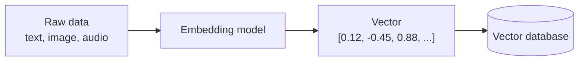

### Intuition: a map of meaning

Imagine every sentence is a pin on a giant map. Sentences with similar meaning sit close together. A vector database is the tool that answers: **"which pins are closest to this one?"**

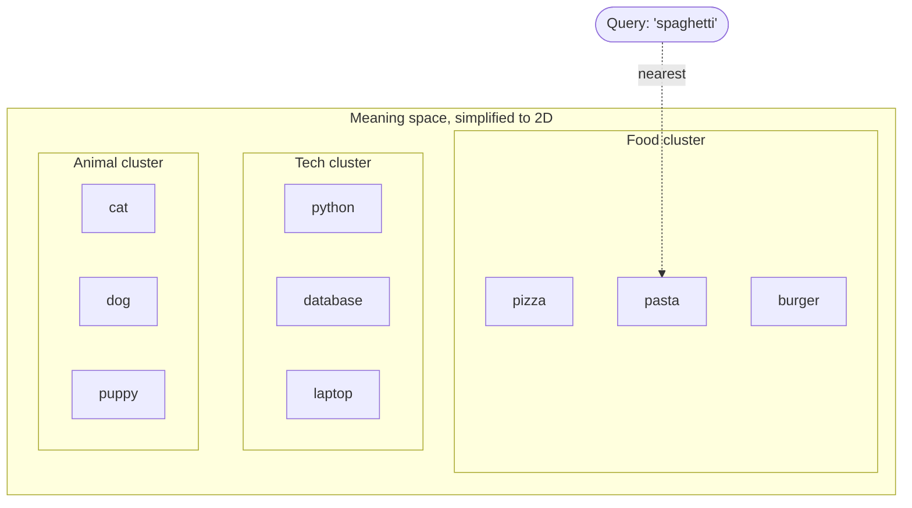

### Traditional database vs vector database

| Feature | Traditional (SQL) DB | Vector DB |
|---|---|---|
| Stores | Rows, columns, text, numbers | Vectors + original data + metadata |
| Search type | Exact match (`WHERE name = 'x'`) | Similarity (nearest neighbours) |
| Understands meaning? | No | Yes (through embeddings) |
| Query example | `SELECT * WHERE title LIKE '%car%'` | "Find items similar to *automobile*" |
| Best for | Structured data, transactions | Semantic search, recommendations, AI/RAG |

---

## 2. Why Do We Need a Vector Database?

### Problem 1: Keyword search misses meaning

Searching for *"cheap places to stay"* with keyword search will **not** find a document titled *"Budget hotels and hostels"*, since no words match. A vector search finds it because the **meaning** is close.

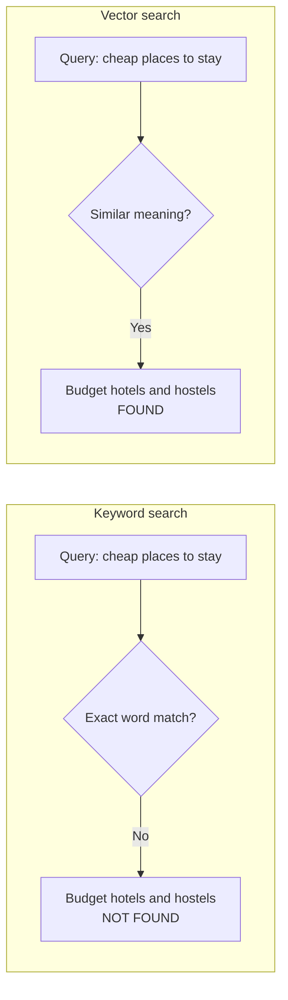

### Problem 2: Large language models forget and hallucinate

LLMs only know what they were trained on. They don't know **your** documents. A vector database lets you fetch the relevant pieces of your own data and hand them to the LLM. This pattern is **RAG (Retrieval-Augmented Generation)**.

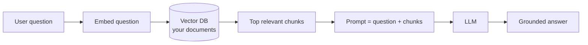

### Problem 3: Brute-force comparison is too slow

Comparing a query against millions of vectors one by one is expensive. Vector databases use **Approximate Nearest Neighbour (ANN)** indexes (such as HNSW) to find close matches in milliseconds.

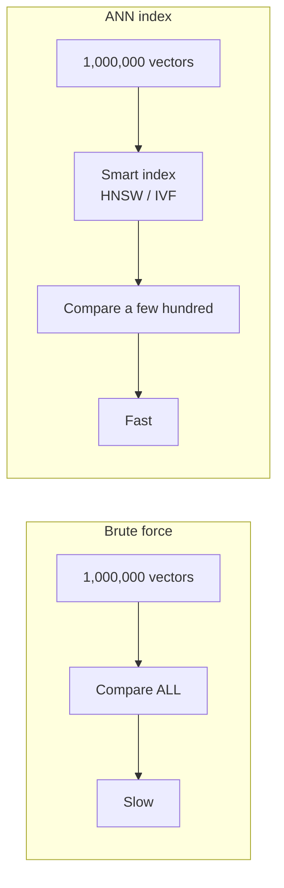

### Real-world use cases

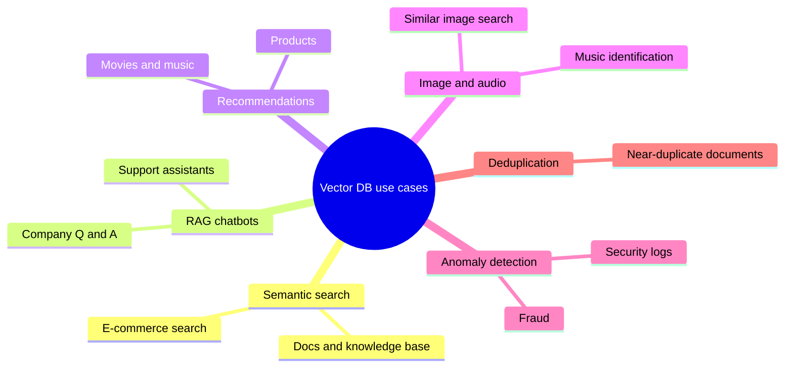

---

## 3. How a Vector Database Works

### The two phases

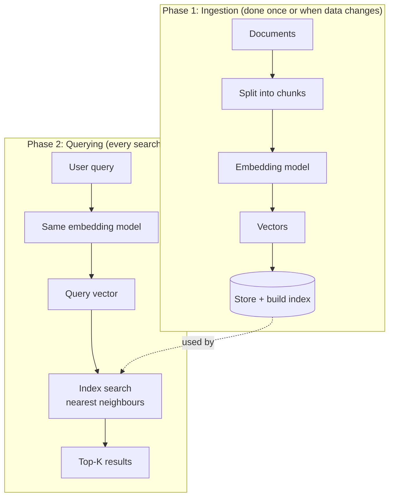

> **Golden rule:** use the **same embedding model** for storing and searching. Vectors from different models live in different "maps" and cannot be compared.

### How "closeness" is measured

| Metric | Idea | Chroma name |
|---|---|---|
| **Cosine similarity** | Angle between vectors (direction) | `cosine` |
| **Euclidean (L2)** | Straight-line distance | `l2` (default) |
| **Inner product** | Dot product | `ip` |

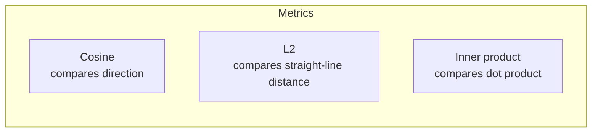

In Chroma, results come back as a **distance**: **smaller = more similar**.

### What happens inside (simplified)

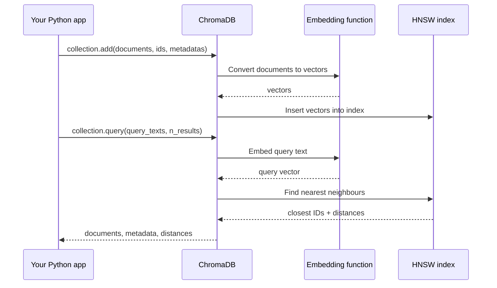

### The HNSW idea (the index Chroma uses)

HNSW (Hierarchical Navigable Small World) builds a multi-layer "highway" graph. Searching starts at the top sparse layer, jumps close to the target, then drops to denser layers to refine.

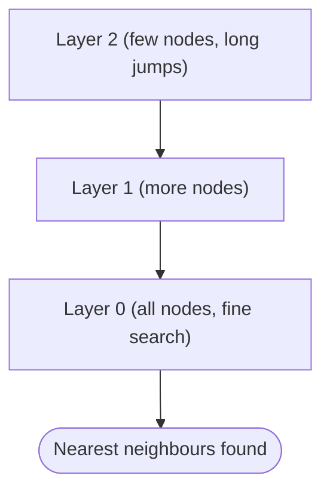

---

## 4. Types of Vector Databases

There are several ways to categorize them. The most useful for beginners is **by what they are**.

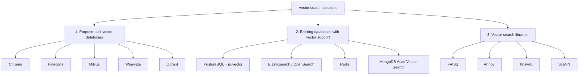

### Comparison table

| Type | Examples | Pros | Cons | Best for |
|---|---|---|---|---|
| **Purpose-built DB** | Chroma, Pinecone, Milvus, Weaviate, Qdrant | Built for vectors, filtering, scaling, easy APIs | Another system to run (unless embedded or managed) | Most AI apps and RAG |
| **Vector extension of existing DB** | pgvector, Elasticsearch, Redis, MongoDB Atlas | Reuse your current stack, one system | May be less optimized at huge scale | Teams already on those DBs |
| **Library** | FAISS, Annoy, hnswlib, ScaNN | Very fast, flexible, free | No persistence, metadata, or server by default (you build it) | Research, custom pipelines |

### By deployment model

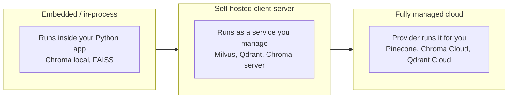

### By index algorithm (what powers the search)

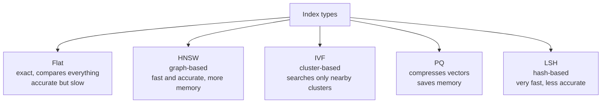

### Which should I choose?

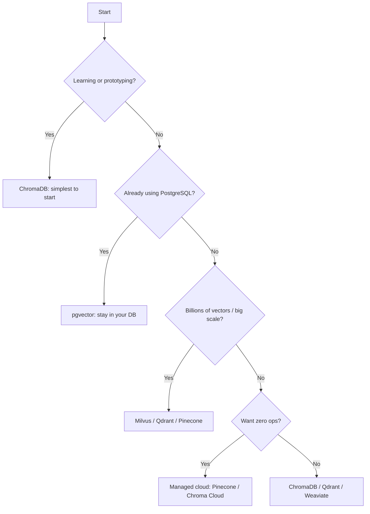

---

## 5. Meet ChromaDB

**ChromaDB** is an open-source, developer-friendly vector database. It is popular for learning and for building LLM apps because it is easy to install, runs inside your Python process, and can embed text for you automatically.

### Key concepts

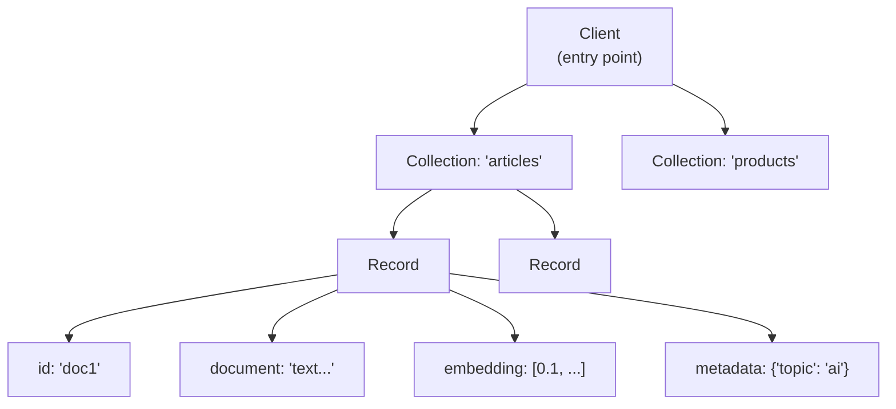

| Concept | Meaning | Analogy |
|---|---|---|
| **Client** | Connection to Chroma (in-memory, persistent, or HTTP) | Database connection |
| **Collection** | A named group of records | A table |
| **Record** | One item: id + document + embedding + metadata | A row |
| **Document** | The original text | A text column |
| **Embedding** | The vector for the document | Auto-generated |
| **Metadata** | Key-value info for filtering | Extra columns |
| **ID** | Unique string per record | Primary key |

### Client types

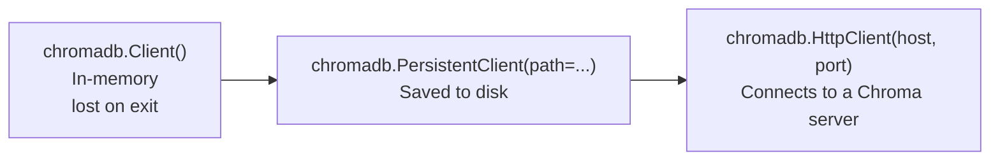

---

## 6. Setup

### Requirements

- Python 3.9 or newer
- pip

### Install

```bash
# Create a virtual environment (recommended)
python -m venv venv

# Activate it
# Windows:
venv\Scripts\activate
# macOS/Linux:
source venv/bin/activate

# Install ChromaDB
pip install chromadb

# Optional, used in Example 8:
pip install sentence-transformers
```

### Verify

```python
import chromadb
print(chromadb.__version__)
```

> **Note:** The first time you use Chroma's default embedding model, it downloads a small model (about 80 MB). This needs internet and happens once.

### Project layout used in this guide

```text
chroma-guide/
├── example01_hello_chroma.py
├── example02_persistent.py
├── ...
└── chroma_data/      <- created automatically in Example 2
```

You can put each example in its own file or run them in a Jupyter notebook.

---

## 7. Hands-On Examples

```mermaid
flowchart LR
    E1["1. Hello Chroma"] --> E2["2. Persistence"] --> E3["3. Collections CRUD"] --> E4["4. Metadata and Get"] --> E5["5. Querying"]
    E5 --> E6["6. Metadata filters"] --> E7["7. Update / Upsert / Delete"] --> E8["8. Custom embeddings"] --> E9["9. Distance metrics"] --> E10["10. Mini RAG pipeline"]
```

---

### Example 1: Hello Chroma (your first semantic search)

**Goal:** create a collection, add documents, and search by meaning.

```python
import chromadb

# 1. Create an in-memory client (data disappears when the script ends)
client = chromadb.Client()

# 2. Create a collection (like a table)
collection = client.create_collection(name="hello_chroma")

# 3. Add documents. Chroma embeds them automatically.
collection.add(
    documents=[
        "Pizza is an Italian dish with cheese and tomato.",
        "Python is a popular programming language.",
        "Dogs are loyal pets that love to play fetch.",
        "The Eiffel Tower is a famous landmark in Paris.",
    ],
    ids=["doc1", "doc2", "doc3", "doc4"],
)

# 4. Search by meaning
results = collection.query(
    query_texts=["Which food comes from Italy?"],
    n_results=2,
)

print(results["documents"])
print(results["distances"])
```

**Expected output (values will vary slightly):**

```text
[['Pizza is an Italian dish with cheese and tomato.', 'The Eiffel Tower is a famous landmark in Paris.']]
[[0.62, 1.31]]
```

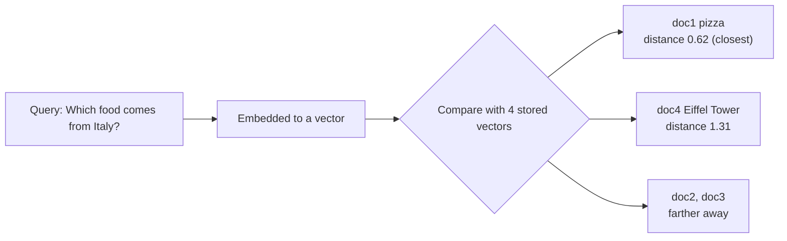

**What you learned**

- `Client()` creates an in-memory database.
- `add()` needs `ids` (unique strings) and `documents`.
- `query()` returns results as **lists of lists**. That is one inner list per query text.
- No keyword in the query matched "pizza", and it still found it. That is semantic search.

---

### Example 2: Persistent storage (keep your data)

**Goal:** save data to disk so it survives restarts.

```python
import chromadb

# Data is stored in the ./chroma_data folder
client = chromadb.PersistentClient(path="./chroma_data")

collection = client.get_or_create_collection(name="notes")

# Only add if empty, to avoid duplicates on re-run
if collection.count() == 0:
    collection.add(
        documents=[
            "Remember to buy milk and eggs.",
            "Team meeting is at 3 PM on Friday.",
            "Read chapter 5 of the machine learning book.",
        ],
        ids=["n1", "n2", "n3"],
    )

print("Total notes:", collection.count())

res = collection.query(query_texts=["schedule for work"], n_results=1)
print(res["documents"][0][0])
```

**Run it twice.** The second run will still show `Total notes: 3`, because the data was loaded from disk.

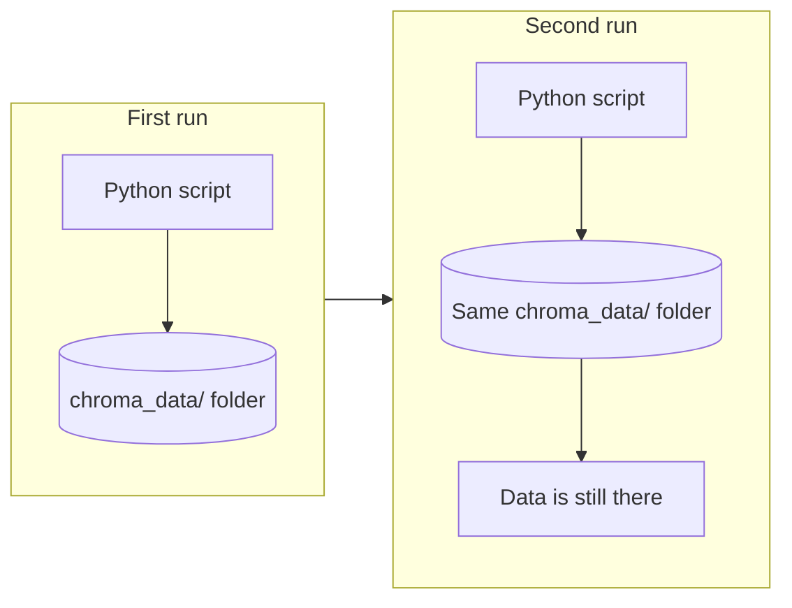

**What you learned**

- `PersistentClient(path=...)` stores data on disk.
- `get_or_create_collection()` is safe to run repeatedly, unlike `create_collection()`, which errors if the name already exists.
- `count()` returns the number of records.

---

### Example 3: Managing collections (create, list, get, rename, delete)

**Goal:** learn the full collection lifecycle.

```python
import chromadb

client = chromadb.PersistentClient(path="./chroma_data")

# Create
books = client.get_or_create_collection(name="books")
movies = client.get_or_create_collection(name="movies")

# List all collections
for c in client.list_collections():
    print("Found collection:", c.name)

# Get an existing collection by name
books = client.get_collection(name="books")
print("Books count:", books.count())

# Rename a collection
movies.modify(name="films")
print("Renamed to:", movies.name)

# Delete a collection (permanent!)
client.delete_collection(name="films")

print("After delete:", [c.name for c in client.list_collections()])
```

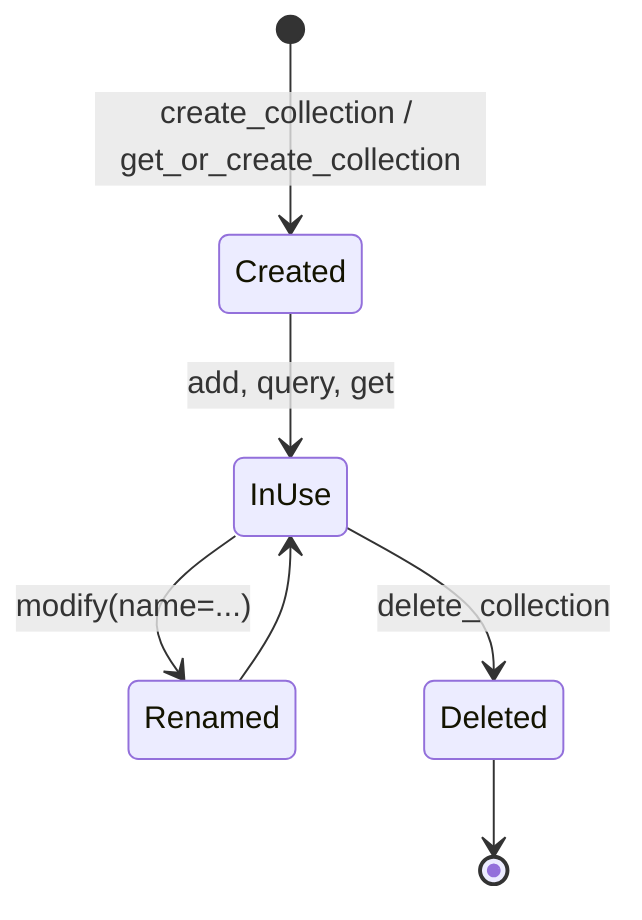

**What you learned**

| Method | Purpose |
|---|---|
| `create_collection(name)` | Make new (errors if it exists) |
| `get_or_create_collection(name)` | Make or reuse |
| `get_collection(name)` | Fetch existing (errors if missing) |
| `list_collections()` | See all collections |
| `collection.modify(name=...)` | Rename |
| `delete_collection(name)` | Remove for good |

> **Tip:** Collection names have rules: 3 to 512 characters, start and end with a letter or digit, and may contain letters, digits, dots, dashes, and underscores.

---

### Example 4: Adding metadata and fetching records with `get()`

**Goal:** attach extra information to each record and retrieve records directly (without similarity search).

```python
import chromadb

client = chromadb.Client()
collection = client.get_or_create_collection(name="articles")

collection.add(
    ids=["a1", "a2", "a3", "a4"],
    documents=[
        "Neural networks learn patterns from data.",
        "Photosynthesis converts sunlight into energy in plants.",
        "Transformers revolutionized natural language processing.",
        "Black holes bend space and time with strong gravity.",
    ],
    metadatas=[
        {"topic": "ai",      "year": 2021, "author": "Asha"},
        {"topic": "biology", "year": 2019, "author": "Ravi"},
        {"topic": "ai",      "year": 2023, "author": "Meena"},
        {"topic": "physics", "year": 2020, "author": "Ravi"},
    ],
)

# get() by ID (no similarity search involved)
one = collection.get(ids=["a1"])
print(one["documents"], one["metadatas"])

# get() several records and choose what to include
many = collection.get(
    ids=["a2", "a3"],
    include=["documents", "metadatas"],
)
print(many["ids"])
print(many["metadatas"])

# Peek at the first few records
print(collection.peek(limit=2)["ids"])
```

**Output (shape):**

```text
['Neural networks learn patterns from data.'] [{'topic': 'ai', 'year': 2021, 'author': 'Asha'}]
['a2', 'a3']
[{'topic': 'biology', 'year': 2019, 'author': 'Ravi'}, {'topic': 'ai', 'year': 2023, 'author': 'Meena'}]
['a1', 'a2']
```

```mermaid
flowchart TB
    R["One record"] --> I["id: 'a1'"]
    R --> D["document: 'Neural networks learn...'"]
    R --> V["embedding: auto-generated"]
    R --> M["metadata"]
    M --> M1["topic: ai"]
    M --> M2["year: 2021"]
    M --> M3["author: Asha"]
```

**What you learned**

- `metadatas` is a list of dictionaries, one per document, in the same order as `documents`.
- Metadata values must be `str`, `int`, `float`, or `bool` (no nested dicts or lists).
- `get()` retrieves by ID or filter, `query()` retrieves by similarity.
- `include=[...]` controls which fields come back. IDs always return.

---

### Example 5: Querying: `n_results`, multiple queries, and distances

**Goal:** understand query results in depth.

```python
import chromadb

client = chromadb.Client()
collection = client.get_or_create_collection(name="animals")

collection.add(
    ids=["1", "2", "3", "4", "5"],
    documents=[
        "A lion is a large wild cat living in Africa.",
        "A house cat likes to nap in the sun.",
        "A shark is a fish that lives in the ocean.",
        "Eagles are birds that soar high in the sky.",
        "A puppy is a young dog that loves to play.",
    ],
)

# Two queries at once
results = collection.query(
    query_texts=["small pet that purrs", "flying animal"],
    n_results=2,
    include=["documents", "distances"],
)

for i, q in enumerate(["small pet that purrs", "flying animal"]):
    print(f"\nQuery: {q}")
    for doc, dist in zip(results["documents"][i], results["distances"][i]):
        print(f"  {dist:.3f}  {doc}")
```

**Possible output:**

```text
Query: small pet that purrs
  0.745  A house cat likes to nap in the sun.
  1.020  A lion is a large wild cat living in Africa.

Query: flying animal
  0.890  Eagles are birds that soar high in the sky.
  1.350  A shark is a fish that lives in the ocean.
```

```mermaid
flowchart TB
    subgraph Input
        Q1["Query 1: small pet that purrs"]
        Q2["Query 2: flying animal"]
    end
    subgraph Output["results dict"]
        R1["documents[0]: results for Query 1"]
        R2["documents[1]: results for Query 2"]
    end
    Q1 --> R1
    Q2 --> R2
```

**Understanding the result structure**

```text
results = {
  "ids":       [[...], [...]],   # one inner list per query
  "documents": [[...], [...]],
  "distances": [[...], [...]],
  "metadatas": [[...], [...]],
}
```

**What you learned**

- `query_texts` accepts multiple queries and returns one result list per query.
- `n_results` is the "top K" to return.
- **Lower distance = more similar.** Results come sorted from closest to farthest.
- Always index with `[0]` for a single query: `results["documents"][0]`.

---

### Example 6: Filtering with metadata (`where` and `where_document`)

**Goal:** combine **semantic search** with **structured filters**.

```python
import chromadb

client = chromadb.Client()
collection = client.get_or_create_collection(name="tech_articles")

collection.add(
    ids=["t1", "t2", "t3", "t4", "t5"],
    documents=[
        "Introduction to neural networks and deep learning.",
        "How to design a REST API with Python Flask.",
        "Transformers and attention explained simply.",
        "Kubernetes basics for container orchestration.",
        "Fine-tuning large language models on custom data.",
    ],
    metadatas=[
        {"category": "ai",     "year": 2020, "level": "beginner"},
        {"category": "web",    "year": 2021, "level": "beginner"},
        {"category": "ai",     "year": 2023, "level": "advanced"},
        {"category": "devops", "year": 2022, "level": "intermediate"},
        {"category": "ai",     "year": 2024, "level": "advanced"},
    ],
)

# 1. Simple equality filter
r1 = collection.query(
    query_texts=["learning about models"],
    n_results=5,
    where={"category": "ai"},
)
print("AI only:", r1["ids"][0])

# 2. Comparison operator ($gt, $gte, $lt, $lte, $ne)
r2 = collection.query(
    query_texts=["learning about models"],
    n_results=5,
    where={"year": {"$gte": 2023}},
)
print("2023 or later:", r2["ids"][0])

# 3. Combine conditions with $and / $or
r3 = collection.query(
    query_texts=["learning about models"],
    n_results=5,
    where={"$and": [{"category": "ai"}, {"level": "advanced"}]},
)
print("AI and advanced:", r3["ids"][0])

# 4. $in operator
r4 = collection.query(
    query_texts=["how to build things"],
    n_results=5,
    where={"category": {"$in": ["web", "devops"]}},
)
print("web or devops:", r4["ids"][0])

# 5. Filter on document text content
r5 = collection.query(
    query_texts=["language processing"],
    n_results=5,
    where_document={"$contains": "models"},
)
print("Docs containing 'models':", r5["ids"][0])
```

```mermaid
flowchart LR
    A["All records"] --> B["Metadata filter<br/>where: category = ai"]
    B --> C["Smaller candidate set"]
    C --> D["Vector similarity ranking"]
    D --> E["Top-K results"]
```

**Operator reference**

| Operator | Meaning | Example |
|---|---|---|
| `$eq` (default) | equals | `{"category": "ai"}` |
| `$ne` | not equal | `{"category": {"$ne": "ai"}}` |
| `$gt`, `$gte` | greater than (or equal) | `{"year": {"$gt": 2020}}` |
| `$lt`, `$lte` | less than (or equal) | `{"year": {"$lte": 2021}}` |
| `$in` | value in list | `{"level": {"$in": ["a", "b"]}}` |
| `$nin` | value not in list | `{"level": {"$nin": ["a"]}}` |
| `$and`, `$or` | combine conditions | `{"$or": [{...}, {...}]}` |
| `$contains` (in `where_document`) | text contains substring | `{"$contains": "models"}` |

**What you learned**

- `where` filters on **metadata**, `where_document` filters on **document text**.
- Filters narrow the candidates, and similarity ranks the rest.
- Combining several conditions needs `$and` or `$or`.

---

### Example 7: Update, upsert, and delete

**Goal:** modify records after creation.

```python
import chromadb

client = chromadb.Client()
collection = client.get_or_create_collection(name="inventory")

collection.add(
    ids=["p1", "p2", "p3"],
    documents=[
        "Wireless mouse with ergonomic design.",
        "Mechanical keyboard with RGB lighting.",
        "27 inch 4K monitor.",
    ],
    metadatas=[
        {"price": 25, "stock": 100},
        {"price": 80, "stock": 40},
        {"price": 300, "stock": 15},
    ],
)

# UPDATE: modify an existing record (the ID must exist)
collection.update(
    ids=["p1"],
    metadatas=[{"price": 22, "stock": 90}],
)
print(collection.get(ids=["p1"])["metadatas"])

# UPDATE the document text (the embedding is recomputed)
collection.update(
    ids=["p3"],
    documents=["32 inch 4K curved gaming monitor."],
)
print(collection.get(ids=["p3"])["documents"])

# UPSERT: update if the ID exists, otherwise insert
collection.upsert(
    ids=["p3", "p4"],   # p3 exists -> updated, p4 is new -> inserted
    documents=[
        "32 inch 4K curved gaming monitor - sale!",
        "USB-C docking station with HDMI.",
    ],
    metadatas=[
        {"price": 280, "stock": 15},
        {"price": 60, "stock": 50},
    ],
)
print("Count after upsert:", collection.count())   # 4

# DELETE by ID
collection.delete(ids=["p2"])

# DELETE by metadata filter
collection.delete(where={"price": {"$gt": 250}})

print("Remaining:", collection.get()["ids"])
```

```mermaid
flowchart TB
    subgraph Ops["Write operations"]
        ADD["add()<br/>new IDs only"]
        UPD["update()<br/>existing IDs only"]
        UPS["upsert()<br/>insert OR update"]
        DEL["delete()<br/>by ids or where"]
    end
    ADD --> X{"ID already exists?"}
    X -- Yes --> E1["add: ignored / warning"]
    X -- No --> OK1["Inserted"]
    UPS --> Y{"ID exists?"}
    Y -- Yes --> U1["Updated"]
    Y -- No --> U2["Inserted"]
```

**What you learned**

| Operation | If ID exists | If ID is missing |
|---|---|---|
| `add` | Not overwritten | Inserted |
| `update` | Updated | Not inserted |
| `upsert` | Updated | Inserted |
| `delete` | Removed | Nothing happens |

> **Tip:** Use `upsert` in data-loading scripts so re-running them never creates duplicates.

---

### Example 8: Using your own embeddings and different embedding models

**Goal:** control *how* text becomes vectors.

By default, Chroma uses a small built-in model. You can (a) choose another embedding function, or (b) supply your own vectors.

#### 8a. Use a Sentence-Transformers model

```python
import chromadb
from chromadb.utils import embedding_functions

# Needs: pip install sentence-transformers
embed_fn = embedding_functions.SentenceTransformerEmbeddingFunction(
    model_name="all-MiniLM-L6-v2"
)

client = chromadb.Client()
collection = client.get_or_create_collection(
    name="custom_embed",
    embedding_function=embed_fn,
)

collection.add(
    ids=["1", "2", "3"],
    documents=[
        "The weather is sunny and warm today.",
        "Heavy rain is expected tomorrow.",
        "The stock market closed higher.",
    ],
)

res = collection.query(query_texts=["Will it be wet outside?"], n_results=1)
print(res["documents"][0][0])
```

#### 8b. Supply your own pre-computed vectors

```python
import chromadb

client = chromadb.Client()
collection = client.get_or_create_collection(name="manual_vectors")

# Tiny 3-dimensional vectors, just for demonstration
collection.add(
    ids=["red", "green", "blue", "orange"],
    embeddings=[
        [1.0, 0.0, 0.0],
        [0.0, 1.0, 0.0],
        [0.0, 0.0, 1.0],
        [0.9, 0.4, 0.0],   # close to red
    ],
    documents=["red", "green", "blue", "orange"],
)

# Query with a vector instead of text
res = collection.query(
    query_embeddings=[[1.0, 0.1, 0.0]],
    n_results=2,
)
print(res["documents"][0])   # ['red', 'orange']
```

```mermaid
flowchart TB
    subgraph Option1["Option A: let Chroma embed"]
        T1["documents=[...]"] --> EF["Embedding function<br/>default or custom"] --> V1["Vectors stored"]
    end
    subgraph Option2["Option B: bring your own vectors"]
        T2["embeddings=[[...], [...]]"] --> V2["Vectors stored directly"]
    end
```

```mermaid
flowchart LR
    VEC["3D space"] --> R["red (1, 0, 0)"]
    VEC --> O["orange (0.9, 0.4, 0)<br/>near red"]
    VEC --> G["green (0, 1, 0)"]
    VEC --> B["blue (0, 0, 1)"]
    Q(["query (1, 0.1, 0)"]) -.closest.-> R
    Q -.second.-> O
```

**What you learned**

- `embedding_function=` sets the model used for both `add` and `query`.
- Pass `embeddings=` and `query_embeddings=` to bypass automatic embedding.
- **Dimension must match** across all vectors in a collection (for example, 384 for MiniLM). Mixing sizes raises an error.
- Always query a collection with the **same embedding function** you used to add data.

---

### Example 9: Distance metrics (l2, cosine, inner product)

**Goal:** see how the metric changes results and distance values.

```python
import chromadb

client = chromadb.Client()

docs = [
    "Machine learning is a subset of artificial intelligence.",
    "Cooking pasta requires boiling water and salt.",
    "Deep learning uses multi-layer neural networks.",
]
ids = ["d1", "d2", "d3"]

for metric in ["l2", "cosine", "ip"]:
    col = client.get_or_create_collection(
        name=f"metric_{metric}",
        metadata={"hnsw:space": metric},   # choose the metric at creation time
    )
    col.add(ids=ids, documents=docs)

    res = col.query(
        query_texts=["What is AI?"],
        n_results=3,
        include=["documents", "distances"],
    )
    print(f"\nMetric: {metric}")
    for d, dist in zip(res["documents"][0], res["distances"][0]):
        print(f"  {dist:8.4f}  {d}")
```

**Possible output (numbers vary):**

```text
Metric: l2
    0.9100  Machine learning is a subset of artificial intelligence.
    1.1200  Deep learning uses multi-layer neural networks.
    1.8700  Cooking pasta requires boiling water and salt.

Metric: cosine
    0.4550  Machine learning is a subset of artificial intelligence.
    0.5600  Deep learning uses multi-layer neural networks.
    0.9350  Cooking pasta requires boiling water and salt.

Metric: ip
   -0.5450  Machine learning is a subset of artificial intelligence.
   -0.4400  ...
```

```mermaid
flowchart TB
    CHOOSE{"Which metric?"} --> COS["cosine<br/>Best for text embeddings<br/>Ignores vector length"]
    CHOOSE --> L2["l2 (default)<br/>Straight-line distance<br/>Sensitive to magnitude"]
    CHOOSE --> IP["ip (inner product)<br/>Fast; for normalized vectors<br/>or recommendation models"]
```

**What you learned**

- Set the metric with `metadata={"hnsw:space": "cosine"}` **when creating** the collection. It cannot be changed afterwards.
- For most text-embedding models, **cosine** is the safest choice.
- Distance values are only comparable **within the same metric**. Don't compare an l2 score to a cosine score.
- Newer Chroma versions also offer a `configuration=` parameter for this. If your version supports it, check the official docs, but `hnsw:space` metadata remains the most widely used form.

---

### Example 10: Mini RAG pipeline (chunking, retrieval, prompt building)

**Goal:** put everything together into a small question-answering retrieval pipeline. The final answer step uses an LLM, which we leave as a placeholder so the example runs without any API key.

```python
import chromadb

# ---------- 1. Source knowledge (pretend this came from files) ----------
knowledge_base = {
    "python_intro.txt": (
        "Python is a high-level programming language created by Guido van Rossum. "
        "It emphasizes readability and supports multiple programming paradigms. "
        "Python is widely used in data science, web development, and automation. "
        "Its large standard library lets developers do a lot without extra packages."
    ),
    "chroma_intro.txt": (
        "ChromaDB is an open-source vector database designed for AI applications. "
        "It stores embeddings along with documents and metadata. "
        "Developers can run Chroma in memory, on disk, or as a client-server setup. "
        "It is commonly used to build retrieval-augmented generation systems."
    ),
    "rag_intro.txt": (
        "Retrieval-augmented generation combines a retriever with a language model. "
        "The retriever finds relevant passages from a knowledge base. "
        "The language model then uses those passages to write a grounded answer. "
        "This reduces hallucination and lets models use private or recent data."
    ),
}

# ---------- 2. Chunking helper ----------
def chunk_text(text, chunk_size=200, overlap=40):
    """Split text into overlapping character chunks."""
    chunks = []
    start = 0
    while start < len(text):
        end = start + chunk_size
        chunks.append(text[start:end].strip())
        start += chunk_size - overlap
    return [c for c in chunks if c]

# ---------- 3. Ingest into Chroma ----------
client = chromadb.PersistentClient(path="./chroma_data")
collection = client.get_or_create_collection(
    name="knowledge_base",
    metadata={"hnsw:space": "cosine"},
)

ids, docs, metas = [], [], []
for filename, text in knowledge_base.items():
    for i, chunk in enumerate(chunk_text(text)):
        ids.append(f"{filename}-{i}")
        docs.append(chunk)
        metas.append({"source": filename, "chunk": i})

collection.upsert(ids=ids, documents=docs, metadatas=metas)
print(f"Stored {collection.count()} chunks")

# ---------- 4. Retrieve ----------
def retrieve(question, k=3):
    res = collection.query(query_texts=[question], n_results=k)
    return list(zip(res["documents"][0], res["metadatas"][0], res["distances"][0]))

# ---------- 5. Build the prompt for an LLM ----------
def build_prompt(question, hits):
    context = "\n".join(f"- ({m['source']}) {d}" for d, m, _ in hits)
    return (
        "Answer the question using ONLY the context below. "
        "If the answer is not in the context, say you don't know.\n\n"
        f"Context:\n{context}\n\n"
        f"Question: {question}\nAnswer:"
    )

# ---------- 6. Run it ----------
question = "What is ChromaDB used for?"
hits = retrieve(question)

print("\nTop matches:")
for doc, meta, dist in hits:
    print(f"  [{dist:.3f}] {meta['source']} (chunk {meta['chunk']}): {doc[:70]}...")

prompt = build_prompt(question, hits)
print("\n--- Prompt that would be sent to an LLM ---")
print(prompt)

# To get a real answer, send `prompt` to any LLM of your choice, for example:
#   answer = my_llm_client.generate(prompt)
```

```mermaid
flowchart TB
    subgraph Ingest["Ingestion (run once)"]
        F["Source files"] --> CH["chunk_text()<br/>200 chars, 40 overlap"]
        CH --> UP["collection.upsert()<br/>+ metadata: source, chunk"]
        UP --> DB[("ChromaDB")]
    end
    subgraph Ask["Question time"]
        Q["User question"] --> RET["retrieve() top-3"]
        DB --> RET
        RET --> PR["build_prompt()<br/>context + question"]
        PR --> LLM["LLM (your choice)"]
        LLM --> ANS["Grounded answer"]
    end
```

```mermaid
sequenceDiagram
    actor User
    participant App as Python app
    participant DB as ChromaDB
    participant LLM
    User->>App: "What is ChromaDB used for?"
    App->>DB: query(question, n_results=3)
    DB-->>App: 3 most relevant chunks + sources
    App->>App: build_prompt(context + question)
    App->>LLM: prompt
    LLM-->>App: answer using only the context
    App-->>User: Answer (with sources)
```

**Why chunk with overlap?**

```mermaid
flowchart LR
    T["Long text"] --> C1["Chunk 1<br/>chars 0-200"]
    T --> C2["Chunk 2<br/>chars 160-360"]
    T --> C3["Chunk 3<br/>chars 320-520"]
    C1 -. "40-char overlap<br/>keeps context across edges" .- C2
    C2 -. overlap .- C3
```

**What you learned**

- Real pipelines **chunk** long documents, because embeddings work best on focused passages.
- **Metadata** (`source`, `chunk`) lets you cite where an answer came from.
- `upsert` makes ingestion safely repeatable.
- RAG = retrieve relevant chunks, put them in a prompt, then ask the LLM.

---

## 8. Cheat Sheet

```python
import chromadb

# --- Clients ---
client = chromadb.Client()                                   # in-memory
client = chromadb.PersistentClient(path="./chroma_data")     # on disk
client = chromadb.HttpClient(host="localhost", port=8000)    # server

# --- Collections ---
col = client.create_collection("name")
col = client.get_or_create_collection("name", metadata={"hnsw:space": "cosine"})
col = client.get_collection("name")
client.list_collections()
client.delete_collection("name")
col.modify(name="new_name")

# --- Write ---
col.add(ids=[...], documents=[...], metadatas=[...], embeddings=[...])
col.update(ids=[...], documents=[...], metadatas=[...])
col.upsert(ids=[...], documents=[...], metadatas=[...])
col.delete(ids=[...])            # or: col.delete(where={...})

# --- Read ---
col.get(ids=[...], where={...}, limit=10, include=["documents", "metadatas"])
col.peek(limit=5)
col.count()

# --- Search ---
col.query(
    query_texts=["..."],          # or query_embeddings=[[...]]
    n_results=5,
    where={"key": "value"},       # metadata filter
    where_document={"$contains": "text"},
    include=["documents", "metadatas", "distances"],
)
```

### Running Chroma as a server (optional)

```bash
chroma run --path ./chroma_data --port 8000
```

```python
import chromadb
client = chromadb.HttpClient(host="localhost", port=8000)
print(client.heartbeat())
```

```mermaid
flowchart LR
    A["Python app 1"] --> S["Chroma server<br/>port 8000"]
    B["Python app 2"] --> S
    C["Notebook"] --> S
    S --> D[("chroma_data/")]
```

---

## 9. Common Mistakes and Tips

| Mistake | Fix |
|---|---|
| `Collection already exists` error | Use `get_or_create_collection()` |
| Duplicate or ignored records on re-run | Use `upsert()` with stable IDs |
| `ids` not unique | Every ID must be a unique string |
| Lists of different lengths | `ids`, `documents`, `metadatas` must have the same length |
| Dimension mismatch error | Use the same embedding model for add and query |
| Forgetting `[0]` on results | Results are nested lists: `results["documents"][0]` |
| Nested metadata or lists | Metadata values must be `str`, `int`, `float`, or `bool` |
| Data gone after restart | Use `PersistentClient`, not `Client()` |
| Wrong metric chosen later | The metric is set at collection creation and cannot be changed, so recreate the collection |
| Poor results on long documents | Chunk text into smaller, focused passages |

### Quick tips

- Start with `cosine` distance for text.
- Keep chunks around 200 to 500 words for real documents (the Example 10 sizes are tiny, for demonstration only).
- Store `source`, `page`, `date`, etc. in metadata. It makes answers citeable and filterable.
- Test retrieval quality *before* adding an LLM. If retrieval is poor, the LLM answer will be too.

```mermaid
flowchart LR
    P["Bad answers?"] --> A{"Check retrieval first"}
    A -- "Wrong chunks" --> B["Improve chunking,<br/>embedding model,<br/>metadata filters"]
    A -- "Right chunks" --> C["Improve the prompt<br/>or LLM"]
```

---

## 10. Where to Go Next

```mermaid
flowchart TD
    N0["You are here: Chroma basics"] --> N1["Try bigger datasets<br/>PDFs, web pages, CSVs"]
    N1 --> N2["Compare embedding models<br/>MiniLM, BGE, OpenAI, etc."]
    N2 --> N3["Add an LLM<br/>complete the RAG loop"]
    N3 --> N4["Learn frameworks<br/>LangChain, LlamaIndex"]
    N4 --> N5["Go to production<br/>Chroma server or cloud, evaluation"]
```

**Practice ideas**

1. Build a semantic search over your own notes or a folder of `.txt` files.
2. Make a movie recommender by embedding plot summaries.
3. Create an FAQ bot over a product manual with metadata filters by section.
4. Compare `l2` vs `cosine` results on the same data.

**Official resources**

- Chroma documentation: https://docs.trychroma.com
- Chroma GitHub: https://github.com/chroma-core/chroma

> **Version note:** ChromaDB evolves quickly. If a parameter or import path behaves differently on your installed version, check the official docs for that version. The core API used here (`add`, `query`, `get`, `update`, `upsert`, `delete`) has been stable.

---

*Happy learning!*
