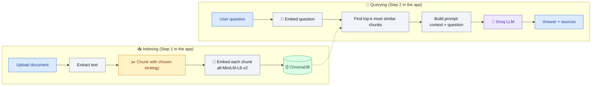
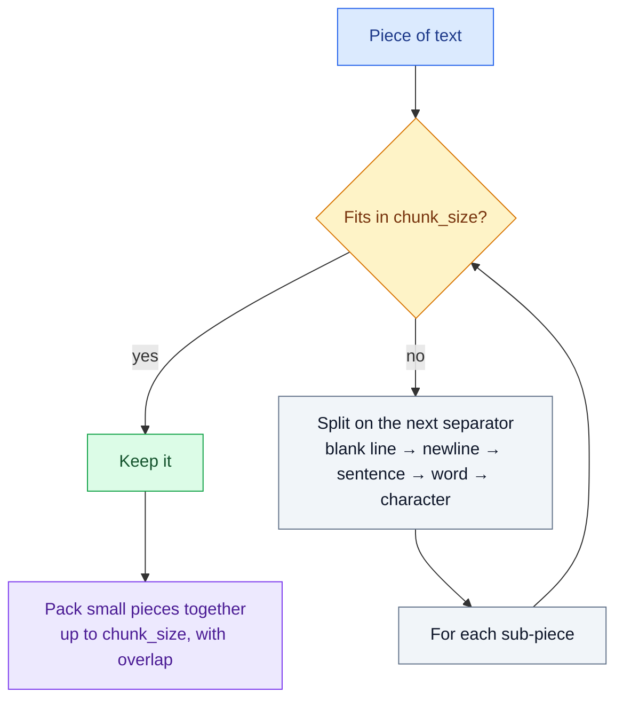

# 📄 Simple RAG — Chunking Strategies Lab

A **very simple** Retrieval-Augmented Generation (RAG) app for absolute beginners.

- 📤 Upload a document (`.txt`, `.md`, `.pdf`)
- ✂️ Choose one of **5 common chunking strategies** and *see* the chunks it creates
- 🧠 Embed chunks with a **free, open-source Hugging Face model** (`all-MiniLM-L6-v2`, runs on CPU)
- 🗄️ Store and search them in **ChromaDB** (a local vector database)
- 💬 Chat with your document — answers are written by a free Groq-hosted LLM
- 📚 Every strategy ships with a **sample document written to show it at its best**

> No API key? The app still works: it shows you the retrieved chunks (the "R" in RAG). The key is only needed for the written answer (the "G").

---

## Table of Contents

1. [What is RAG? (in plain English)](#1-what-is-rag-in-plain-english)
2. [How this app works](#2-how-this-app-works)
3. [Project structure](#3-project-structure)
4. [Step-by-step setup](#4-step-by-step-setup)
5. [Using the app](#5-using-the-app)
6. [Chunking — the big idea](#6-chunking--the-big-idea)
7. [Strategy 1 — Fixed-size chunking](#7-strategy-1--fixed-size-chunking)
8. [Strategy 2 — Sentence-based chunking](#8-strategy-2--sentence-based-chunking)
9. [Strategy 3 — Paragraph-based chunking](#9-strategy-3--paragraph-based-chunking)
10. [Strategy 4 — Recursive character chunking](#10-strategy-4--recursive-character-chunking)
11. [Strategy 5 — Semantic chunking](#11-strategy-5--semantic-chunking)
12. [Side-by-side comparison](#12-side-by-side-comparison)
13. [Which strategy should I choose?](#13-which-strategy-should-i-choose)
14. [Experiments to try](#14-experiments-to-try)
15. [Troubleshooting](#15-troubleshooting)
16. [Glossary](#16-glossary)

---

## 1. What is RAG? (in plain English)

A Large Language Model (LLM) only knows what it saw during training. It has never read *your* leave policy, *your* server logs or *your* notes.

**RAG** fixes this with an open-book exam approach:

1. **Retrieve** — find the few parts of your document that are relevant to the question.
2. **Augment** — paste those parts into the prompt.
3. **Generate** — let the LLM answer *using only those parts*.

```
   Without RAG                         With RAG
 ┌──────────────┐                ┌──────────────────────────────┐
 │  Question    │                │  Question                    │
 │      │       │                │      │                       │
 │      ▼       │                │      ▼                       │
 │    LLM  ──► guesses /          │  Search YOUR document        │
 │           makes things up      │      │  (top 3 chunks)       │
 └──────────────┘                │      ▼                       │
                                 │  LLM + chunks ──► grounded   │
                                 │                   answer     │
                                 └──────────────────────────────┘
```

---

## 2. How this app works

There are two phases: **indexing** (once per document) and **querying** (every question).



**What's an embedding?** A list of numbers (here, 384 numbers) that captures the *meaning* of a piece of text. Texts with similar meaning get similar numbers, so "How many sick days do I get?" lands close to the paragraph about sick leave — even without sharing exact words. ChromaDB's job is to find the closest ones quickly.

| Component | What we use | Why |
|---|---|---|
| UI | Streamlit | A web app in pure Python, no HTML/JS needed |
| Chunking | `chunking.py` (hand-written) | Every strategy is ~20 readable lines — no hidden magic |
| Embeddings | `sentence-transformers/all-MiniLM-L6-v2` | Free, open source, ~90 MB, fast on CPU |
| Vector DB | ChromaDB (`PersistentClient`, cosine distance) | Runs locally, zero setup, saves to `chroma_db/` |
| LLM | Groq (`openai/gpt-oss-20b` by default) | Free tier, very fast; swappable in the sidebar |

---

## 3. Project structure

```
simple-rag-chunking/
├── app.py                 ← Streamlit app: upload, chunk, store, chat
├── chunking.py            ← The 5 chunking strategies (read this file!)
├── requirements.txt       ← Python packages to install
├── .env.example           ← Template for your Groq API key
├── .gitignore
├── README.md              ← You are here
└── sample_documents/
    ├── 1_fixed_size_server_logs.txt       ← for Fixed-size
    ├── 2_sentence_based_space_facts.txt   ← for Sentence-based
    ├── 3_paragraph_based_leave_policy.txt ← for Paragraph-based
    ├── 4_recursive_python_handbook.md     ← for Recursive
    └── 5_semantic_travel_blog.txt         ← for Semantic
```

`chroma_db/` is created automatically the first time you store chunks.

---

## 4. Step-by-step setup

### Step 0 — Prerequisites

- **Python 3.10, 3.11, 3.12 or 3.13** → check with `python --version`
  - Windows: install from [python.org](https://www.python.org/downloads/) and **tick "Add python.exe to PATH"** on the first installer screen.
- About **2 GB free disk space** (PyTorch, which `sentence-transformers` needs, is large).
- Internet access for the first run (to download packages and the embedding model).

### Step 1 — Open a terminal in the project folder

Unzip the project, then:

```bash
cd simple-rag-chunking
```

(On Windows you can open the folder in File Explorer, click the address bar, type `powershell` and press Enter.)

### Step 2 — Create a virtual environment

A virtual environment keeps this project's packages separate from everything else on your computer.

**Windows (PowerShell)**
```powershell
python -m venv .venv
.venv\Scripts\Activate.ps1
```
> If you see *"running scripts is disabled on this system"*, run this once, then activate again:
> `Set-ExecutionPolicy -Scope CurrentUser RemoteSigned`

**Windows (Command Prompt)**
```cmd
python -m venv .venv
.venv\Scripts\activate.bat
```

**macOS / Linux**
```bash
python3 -m venv .venv
source .venv/bin/activate
```

✅ Your prompt should now start with `(.venv)`.

### Step 3 — Install the packages

```bash
python -m pip install --upgrade pip
pip install -r requirements.txt
```

This takes a few minutes the first time.

> 💡 **Linux only, optional:** to avoid downloading the multi-GB GPU version of PyTorch, install the CPU build *first*:
> `pip install torch --index-url https://download.pytorch.org/whl/cpu`, then run `pip install -r requirements.txt`.
> (Windows and macOS get a CPU build by default.)

### Step 4 — Get a free Groq API key (optional but recommended)

1. Sign up at [console.groq.com](https://console.groq.com/).
2. Go to **API Keys** → **Create API Key** → copy it.
3. Copy the template and paste your key:

   **Windows:** `copy .env.example .env`  **macOS/Linux:** `cp .env.example .env`

4. Open `.env` and replace `your_groq_api_key_here` with your key.

You can also skip `.env` and paste the key into the sidebar while the app is running.

> Groq retires models from time to time. If you get a "model not found / decommissioned" error, pick a current model from [console.groq.com/docs/models](https://console.groq.com/docs/models) and type it in the sidebar's **Model** box (or set `GROQ_MODEL` in `.env`).

### Step 5 — Run the app

```bash
streamlit run app.py
```

Your browser opens at **http://localhost:8501**. The first time you chunk a document, the embedding model (~90 MB) downloads from Hugging Face — that happens once and is cached.

To stop the app, press **Ctrl + C** in the terminal. Next time, you only need Step 2's *activate* command and Step 5.

---

## 5. Using the app

```
┌───────────── Sidebar ─────────────┐ ┌──────────────── Main page ─────────────────┐
│ ⚙️ Chunking strategy  [dropdown]   │ │ Step 1 · Add a document                     │
│   ℹ️ what this strategy does        │ │   [Upload file]   or  [📥 Load sample]      │
│   sliders for its settings         │ │   [✂️ Chunk & store in ChromaDB]            │
│ 🔎 Top-k chunks to retrieve        │ │   Chunks | Avg | Shortest | Longest         │
│ 🤖 Groq API key + model            │ │   🧩 See every chunk  (expand me!)          │
│ Chunks stored: 12                  │ │ Step 2 · Chat with your document            │
│ [🗑️ Clear database & chat]          │ │   💬 ... answer + 📚 retrieved chunks       │
└────────────────────────────────────┘ └─────────────────────────────────────────────┘
```

1. **Pick a strategy** in the sidebar.
2. Click **📥 Load sample** (or upload your own file).
3. Click **✂️ Chunk & store in ChromaDB**.
4. Open **🧩 See every chunk** — this is the most educational part. Look at *where* each chunk starts and ends.
5. Ask a question in the chat box. Open **📚 Retrieved chunks** under the answer to see exactly what the LLM was given and the similarity score of each chunk (closer to 1.0 = more similar).

**"Replace documents already in the database"** is ticked by default, so each new run replaces the previous one — ideal for comparing strategies on the same document. Untick it to add several documents together.

---

## 6. Chunking — the big idea

### Why can't we just embed the whole document?

Three reasons:

1. **Embedding models have an input limit.** `all-MiniLM-L6-v2` reads at most **256 tokens (~1,000 characters)**. Everything after that is silently cut off — so a whole document would be embedded from its first page only.
2. **One vector for many topics is blurry.** A vector representing "leave policy + holidays + work-from-home + encashment" is a vague average that matches nothing well.
3. **LLM prompts should be focused.** Sending only the 3 most relevant pieces is cheaper, faster, and produces better, less confused answers than pasting the whole document.

So we cut the document into **chunks** — small pieces, each about one idea — and embed each one separately.

### The Goldilocks problem

```
 Too SMALL                       Just right                     Too BIG
 "18 days"                       "Every full-time employee      [entire 3-page policy]
                                  receives 18 days of annual
 ❌ No context — 18 days of       leave per year..."             ❌ Blurry meaning, retrieval
    what?                                                           is hit-or-miss, wastes
                                 ✅ One complete idea               LLM context
```

Every chunking strategy is really just a different answer to: **"Where should one idea end and the next begin?"**

### Two knobs you'll see everywhere

- **Chunk size** — how big each chunk may be (characters, sentences, …).
- **Overlap** — how much of the end of one chunk is repeated at the start of the next. Overlap is a safety net: if an important sentence lands on a boundary, it still appears whole in at least one chunk.

```
Text:     [■■■■■■■■■■■■■■■■■■■■■■■■■■■■■■■■■■■■]
Chunk 1:  [■■■■■■■■■■■■]
Chunk 2:            [■■■■■■■■■■■■]        ◄── the shaded part is the overlap
Chunk 3:                      [■■■■■■■■■■■■]
```

A common starting point is overlap ≈ **10–20%** of chunk size. More overlap = safer but more duplicated storage and more near-identical search results.

---

## 7. Strategy 1 — Fixed-size chunking

### What it does
Cuts the text every **N characters**, no matter what is there — middle of a word, sentence, or line.

```
"...ERROR [order-service] Database connection pool exhausted, request ti|med out after 30000ms..."
                                                                         ▲
                                                           cut at exactly 500 characters
```

### How the code works (`fixed_size_chunking`)
```
start = 0
repeat:
    chunk = text[start : start + chunk_size]
    start = start + (chunk_size - overlap)     # step forward, keeping some overlap
```

### Settings in the app
| Setting | Default | Effect |
|---|---|---|
| Chunk size | 500 chars | Bigger = fewer, broader chunks |
| Chunk overlap | 50 chars | Repeats the last 50 chars at the start of the next chunk |

### Why and when to use it
Use it when the text has **no reliable structure** you can follow, or when you need **predictable, uniform** chunk sizes:
- Log files, sensor/event streams, raw OCR output, scraped text with broken formatting
- Quick prototypes and **baselines** — always measure smarter strategies against this
- Very large datasets where speed and simplicity matter more than perfect boundaries

### ✅ Pros
- Simplest possible algorithm; anyone can understand and debug it
- Extremely fast — no parsing, no models
- Every chunk is nearly the same size → predictable cost and never exceeds model limits
- Works on any language and any text format

### ❌ Cons
- **Cuts words and sentences in half** ("ti | med out"), which slightly damages the meaning of both chunks
- Ignores structure — a heading can end up in a different chunk than its content
- Related information may be split across two chunks; needs overlap to compensate
- Overlap duplicates content, increasing storage and causing near-duplicate search hits

### 🧪 Sample: `1_fixed_size_server_logs.txt`
Server logs are uniform, line-based, and every line is self-contained — so a fixed cut does little harm. Default settings produce **8 chunks of ~440–500 characters**.

Try asking:
- *"Why did the order service return a 503 error?"*
- *"Which account was locked and why?"*
- *"What happened with the SMTP server?"*
- *"Which version of payment-service was deployed and by whom?"*

👀 **Observe:** open the chunks and find a log line split across two chunks. Then set overlap to 0 and ask about that line — retrieval often gets worse. That's why overlap exists.

---

## 8. Strategy 2 — Sentence-based chunking

### What it does
Splits the text into **sentences** first, then groups **N sentences** per chunk. A sentence is never cut in half.

```
[S1 S2 S3 S4] [S4 S5 S6 S7] [S7 S8 S9 S10] ...
          ▲             ▲
   1 sentence of overlap carried forward
```

### How the code works (`sentence_chunking`)
1. `split_into_sentences()` breaks the text after `.`, `!` or `?` followed by a space.
2. Sentences are grouped into windows of `sentences_per_chunk`, stepping forward by `sentences_per_chunk − overlap_sentences`.

> ℹ️ The splitter is deliberately simple. It would wrongly split "Dr. Rao" after "Dr.". Real projects often use **nltk** or **spaCy** for sentence detection.

### Settings in the app
| Setting | Default | Effect |
|---|---|---|
| Sentences per chunk | 4 | More = more context per chunk, less precise matching |
| Overlapping sentences | 1 | Sentences repeated between neighbouring chunks |

### Why and when to use it
Use it when the **sentence is the natural unit of meaning** and each sentence carries a fact:
- FAQs, fact sheets, glossaries, product specs written in prose
- News, encyclopaedia-style text, customer reviews, chat transcripts
- When you want chunks that always read as **grammatically complete**

### ✅ Pros
- Never breaks a sentence → every chunk is readable and meaningful
- Simple and fast (no model needed)
- Great precision for fact-style questions: the matching chunk is small and focused
- Easy for beginners to reason about ("each chunk = 4 sentences")

### ❌ Cons
- Chunk **sizes vary** a lot (a 4-sentence chunk can be 150 or 1,500 characters), so very long sentences can still overflow model limits
- Ignores paragraphs/sections — sentence groups can straddle two unrelated topics
- Depends on punctuation; fails on text without it (logs, code, bullet lists, poorly OCR'd text)
- Abbreviations, decimals and URLs can fool simple splitters

### 🧪 Sample: `2_sentence_based_space_facts.txt`
A fact sheet where **every sentence is a standalone fact**, written as dense blocks (so paragraph splitting wouldn't help much). Default settings produce **13 chunks**.

Try asking:
- *"Why is Venus hotter than Mercury?"*
- *"What is the tallest volcano in the solar system?"*
- *"When did Chandrayaan-3 land and where?"*
- *"How long does sunlight take to reach Earth?"*

👀 **Observe:** set sentences-per-chunk to 1 and ask *"Which planet has the most moons and what is the biggest one?"* — the answer needs two sentences, so tiny chunks may miss half of it. Then try 4. This is the size/precision trade-off in action.

---

## 9. Strategy 3 — Paragraph-based chunking

### What it does
Treats each **paragraph** (text separated by a blank line) as one chunk, trusting the author's own structure.

Two safety rules are built in:
- **Tiny paragraphs** (shorter than *min chars*, like the heading `3. Sick Leave`) are glued onto the next paragraph, so headings stay with their content.
- **Huge paragraphs** (longer than *max chars*) are split by sentences so no chunk becomes enormous.

```
"3. Sick Leave"            ─┐
                            ├──► Chunk: "3. Sick Leave\nEmployees receive 10 days..."
"Employees receive 10 ..." ─┘
```

### How the code works (`paragraph_chunking`)
1. Split on blank lines: `re.split(r"\n\s*\n", text)`.
2. Merge paragraphs shorter than `min_chars` into the next one.
3. Split paragraphs longer than `max_chars` on sentence boundaries.

### Settings in the app
| Setting | Default | Effect |
|---|---|---|
| Merge paragraphs shorter than | 100 chars | Keeps headings attached to their section (0 = off) |
| Split paragraphs longer than | 1,500 chars | Safety limit for giant paragraphs |

### Why and when to use it
Use it when the document is **well-written and well-formatted**, so each paragraph already covers one topic:
- Policies, contracts, terms & conditions, SOPs, HR handbooks
- Reports, essays, articles, books, documentation with clear paragraphs
- Anywhere a human editor has already done the "one idea per block" work

### ✅ Pros
- Respects the author's logical structure → chunks are coherent, complete topics
- Headings stay with their content (with the merge rule), which boosts retrieval
- Simple, fast, no model needed
- Chunks are easy to cite back to users ("see section 3")

### ❌ Cons
- Only as good as the formatting — useless on text with no blank lines (like sample 5) or broken PDF extraction
- Paragraph sizes vary wildly: one-line paragraphs are too thin, wall-of-text paragraphs too broad
- PDFs often lose or invent blank lines when converted to text, producing odd splits
- A topic spanning several paragraphs gets split across chunks

### 🧪 Sample: `3_paragraph_based_leave_policy.txt`
An HR policy with numbered sections, each a heading + one paragraph — the perfect case. Default settings produce **10 chunks: exactly one per section**, each starting with its heading.

Try asking:
- *"How many sick leave days do I get and when do I need a medical certificate?"*
- *"Can I carry forward unused annual leave?"*
- *"How long is paternity leave?"*
- *"What happens to my leave balance when I resign?"*

👀 **Observe:** set *merge shorter than* to **0** and re-chunk. Headings like `3. Sick Leave` now become their own useless chunks. Then try **Fixed-size (500)** on the same document and ask the sick-leave question — notice how a single section gets split mid-sentence.

---

## 10. Strategy 4 — Recursive character chunking

### What it does
The "smart default" used by frameworks like LangChain (`RecursiveCharacterTextSplitter`). It tries the **biggest natural boundary first** and only falls back to smaller ones when a piece is still too big:

```
Try to split on:  "\n\n"  →  "\n"  →  ". "  →  " "  →  "" (characters)
                paragraph    line    sentence   word    last resort
```

Small pieces are then **packed back together** until a chunk is nearly full, with overlap between chunks.



### How the code works (`recursive_chunking`)
- `_recursive_split()` splits on the current separator; any part still larger than `chunk_size` is split again with the *next* separator.
- `_merge_pieces()` greedily joins small parts back together up to `chunk_size`, keeping some trailing pieces as overlap.

### Settings in the app
| Setting | Default | Effect |
|---|---|---|
| Chunk size | 500 chars | Upper limit for each chunk |
| Chunk overlap | 50 chars | Repeated context between neighbours |

### Why and when to use it
Use it as your **default for almost any document**, especially when:
- The document mixes structures: headings, paragraphs of different lengths, bullet lists, short code lines
- Markdown, documentation, wikis, READMEs, tutorials, emails, web pages
- You need a **guaranteed maximum size** (to fit the embedding model) *and* sensible boundaries

### ✅ Pros
- Best balance of **structure-awareness and size control** — it respects paragraphs when it can, and still never exceeds the limit
- Works reasonably on almost any text, structured or not
- No model needed; fast
- Industry-standard default, so results are comparable with tutorials and other projects

### ❌ Cons
- Still **purely character-based**: it doesn't know what the text *means*, so two unrelated short sections can be packed into one chunk
- Choosing chunk size/overlap still requires experimentation
- Slightly harder to explain and debug than fixed or sentence chunking
- Default separators are tuned for prose; code or tables need custom separators

### 🧪 Sample: `4_recursive_python_handbook.md`
A Markdown handbook with headings, short and long paragraphs, bullet lists and one-line commands. Paragraph chunking would give uneven chunks; fixed-size would cut through lists and commands. Recursive produces **12 chunks of ~285–480 characters**, mostly aligned to sections and paragraphs.

Try asking:
- *"How do I activate a virtual environment on Windows?"*
- *"What should I do if PowerShell says running scripts is disabled?"*
- *"How do I stop an infinite loop?"*
- *"Why should I avoid a bare except?"*

👀 **Observe:** compare chunks with **Fixed-size (500)** on the same file — recursive chunks start at headings/paragraphs, fixed ones start mid-word. Then try recursive with chunk size **200** and see it fall back to sentences and words.

---

## 11. Strategy 5 — Semantic chunking

### What it does
Instead of counting characters or trusting formatting, it **uses the embedding model to detect where the topic changes**, and cuts there.

```
Sentence:   1   2   3 │ 4   5   6   7 │ 8   9  10 │ 11  12
Topic:     travel    │ temple        │ food      │ weather ...
Distance:  .2  .1  .7│.2  .1  .3  .8 │.1  .2  .6 │ .1
                   ▲                ▲          ▲
           big jumps in meaning → chunk boundaries
```

### How the code works (`semantic_chunking`)
1. Split into sentences.
2. For each sentence, build a small **window** (the sentence plus `buffer_size` neighbours on each side) — this smooths out noise from very short sentences.
3. **Embed** every window.
4. Compute the **cosine distance** between each window and the next (`1 − similarity`).
5. Find the distances above the **breakpoint percentile** (e.g. the top 15% biggest jumps when set to 85) → start a new chunk there.

### Settings in the app
| Setting | Default | Effect |
|---|---|---|
| Breakpoint percentile | 85 | **Lower** → more cuts, smaller chunks. **Higher** → fewer cuts, bigger chunks |
| Sentence buffer | 1 | Neighbours included when comparing; 0 = compare raw sentences (noisier) |

### Why and when to use it
Use it when the text **changes topic without any formatting clues**, and boundary quality matters more than speed:
- Long blog posts, transcripts (meetings, podcasts, YouTube, lectures), interviews
- Stream-of-consciousness notes, emails, chat logs, badly formatted PDFs
- High-value knowledge bases where better retrieval justifies extra cost

### ✅ Pros
- Chunks follow **meaning**, so each chunk tends to be one coherent topic
- Works even when there are no paragraphs, headings or blank lines
- Usually gives the most "human-like" boundaries
- Adapts automatically: long topics produce long chunks, short topics short ones

### ❌ Cons
- **Slowest and most expensive**: every sentence window must be embedded before chunking (with a paid embedding API, this costs money)
- Results depend on the embedding model and the percentile — less predictable, harder to debug
- **No size guarantee**: a long single-topic section becomes one huge chunk (production systems add a max-size fallback, often recursive splitting)
- Relies on sentence splitting, so it struggles with logs, code and tables
- Research shows it does not *always* beat a well-tuned recursive splitter — measure before committing

### 🧪 Sample: `5_semantic_travel_blog.txt`
A Madurai travel blog written as **one giant paragraph** that drifts across topics: the train journey → Meenakshi temple → food → weather → palace history → budget. Paragraph chunking finds no blank lines, so it can only chop the text wherever the size limit is hit; fixed-size cuts straight through topics. Semantic chunking finds the topic shifts.

Try asking:
- *"What is jigarthanda and where can I get it?"*
- *"What is the best time of year to visit Madurai?"*
- *"Who built Thirumalai Nayakkar Mahal and when?"*
- *"How much did the whole trip cost?"*

👀 **Observe:** open the chunks and label each with a topic — do they line up with food / weather / history? Change the percentile to 70 and 95 and watch the number of chunks change. Then try **Paragraph-based** on this file: with no blank lines, its chunks are cut by the size limit alone, not by topic.

---

## 12. Side-by-side comparison

| | Fixed-size | Sentence | Paragraph | Recursive | Semantic |
|---|---|---|---|---|---|
| **Splits on** | Character count | Sentence endings | Blank lines | `\n\n` → `\n` → `. ` → ` ` | Meaning changes |
| **Breaks sentences?** | Often ❌ | Never ✅ | Rarely ✅ | Rarely ✅ | Never ✅ |
| **Size control** | Exact ✅ | Loose | Loose (with max) | Guaranteed max ✅ | None ❌ |
| **Needs structure?** | No | Punctuation | Blank lines | Helps, not required | Punctuation |
| **Needs a model?** | No | No | No | No | Yes (embeddings) |
| **Speed** | ⚡⚡⚡ | ⚡⚡⚡ | ⚡⚡⚡ | ⚡⚡⚡ | ⚡ |
| **Chunk coherence** | ★☆☆ | ★★☆ | ★★★ (if well formatted) | ★★☆ | ★★★ |
| **Ease of tuning** | Easy | Easy | Easy | Medium | Hard |
| **Best for** | Logs, raw streams, baselines | FAQs, fact sheets, reviews | Policies, contracts, articles | Docs, Markdown, general use | Transcripts, blogs, messy text |
| **Sample file** | Server logs | Space facts | Leave policy | Python handbook | Travel blog |

---

## 13. Which strategy should I choose?

```mermaid
flowchart TD
    S([Start: look at your document]):::start --> A{Has clear paragraphs<br/>separated by blank lines?}:::q
    A -- Yes, one topic each --> P[3 · Paragraph-based]:::res
    A -- Mixed / Markdown --> R[4 · Recursive]:::res
    A -- No formatting --> B{Normal sentences<br/>with punctuation?}:::q
    B -- No: logs, codes, streams --> F[1 · Fixed-size]:::res
    B -- Yes --> C{Topic changes often<br/>& quality matters most?}:::q
    C -- Yes --> SE[5 · Semantic]:::res
    C -- No, independent facts --> SN[2 · Sentence-based]:::res
    classDef start fill:#dbeafe,stroke:#2563eb,color:#1e3a8a
    classDef q fill:#fef3c7,stroke:#d97706,color:#78350f
    classDef res fill:#dcfce7,stroke:#16a34a,color:#14532d
```



**Not sure? Start with Recursive (500 chars, 50 overlap).** It's the safest default. Then try one other strategy on *your* documents with *your* real questions, and keep whichever retrieves the right chunks more often.

Rules of thumb:
- Precise fact questions ("how many days…") → smaller chunks (200–500 chars).
- Explanation questions ("why…", "summarise…") → bigger chunks (800–1,500 chars) or larger top-k.
- Keep chunks well under the embedding model's limit (~1,000 characters for `all-MiniLM-L6-v2`).

---

## 14. Experiments to try

1. **Same question, five strategies.** Load the leave policy, ask *"When do I need a medical certificate?"* with each strategy, and compare the top similarity scores and the retrieved chunks.
2. **Overlap matters.** Fixed-size on the logs with overlap 0 vs 100.
3. **Too small vs too big.** Recursive on the handbook with chunk size 150, 500 and 2,000. Which answers best?
4. **Wrong tool for the job.** Paragraph chunking on the travel blog (chunks cut only by the size limit) vs semantic.
5. **Top-k.** Ask a question whose answer spans two sections (e.g. *"Compare sick leave and casual leave"*) with top-k = 1, then 4.
6. **Your own PDF.** Upload a PDF and see what text extraction does to its paragraphs.

---

## 15. Troubleshooting

| Problem | Fix |
|---|---|
| `'python' is not recognized` (Windows) | Reinstall Python and tick **Add python.exe to PATH**, or use `py` instead of `python` |
| `running scripts is disabled on this system` | `Set-ExecutionPolicy -Scope CurrentUser RemoteSigned`, then activate again |
| `ModuleNotFoundError: No module named ...` | Your venv is not active (no `(.venv)` in prompt) → activate it, then `pip install -r requirements.txt` |
| Torch install fails / is huge | Use Python 3.10–3.13; on Linux install the CPU build first (see Step 3) |
| First chunking is very slow | The embedding model is downloading (one time only) |
| `model ... has been decommissioned` / not found | Pick a current model at [console.groq.com/docs/models](https://console.groq.com/docs/models) and enter it in the sidebar |
| `401 Invalid API Key` | Re-copy the key; make sure `.env` has no quotes or spaces around it |
| `Invalid settings: chunk_overlap must be smaller...` | Lower the overlap slider below the chunk size |
| Answers mention old documents | Click **🗑️ Clear database & chat**, or delete the `chroma_db/` folder |
| PDF gives empty text | It's a scanned image PDF; it needs OCR, which this simple app doesn't do |
| Port 8501 already in use | `streamlit run app.py --server.port 8502` |

---

## 16. Glossary

| Term | Meaning |
|---|---|
| **RAG** | Retrieval-Augmented Generation: find relevant text, then let an LLM answer using it |
| **Chunk** | A small piece of a document that is embedded and searched on its own |
| **Chunk overlap** | Text repeated between neighbouring chunks to protect boundary information |
| **Embedding** | A list of numbers representing the meaning of a text |
| **Embedding model** | The model that creates embeddings — here `all-MiniLM-L6-v2` (384 numbers per text) |
| **Vector database** | A database that stores embeddings and quickly finds the most similar ones (ChromaDB) |
| **Cosine similarity** | How closely two embeddings point in the same direction (1 = same meaning, 0 = unrelated) |
| **Cosine distance** | `1 − cosine similarity`; ChromaDB returns this, the app converts it back to similarity |
| **Top-k** | How many of the most similar chunks to retrieve per question |
| **Token** | The unit models read text in; roughly ¾ of an English word |
| **Percentile** | In semantic chunking, the cut-off for what counts as a "big" jump in meaning |

---

### Where to go next
- Add a **max-size fallback** to semantic chunking (split oversized chunks with `recursive_chunking`).
- Try a stronger embedding model such as `BAAI/bge-small-en-v1.5` (change `EMBEDDING_MODEL` in `app.py`; re-chunk afterwards).
- Store a `section` or `page` number in each chunk's metadata for better citations.
- Measure retrieval quality with an evaluation framework such as RAGAS instead of eyeballing results.
