# 📏 Distance Metrics in Vector Databases for Absolute Beginners

A hands-on guide with **10 Python examples**, **matplotlib charts**, and **Mermaid diagrams**.

> **Goal:** Learn *what* each distance metric is, *why* it exists, *when* to use it, and how to choose the right one for your vector database.

---

## 📚 Table of Contents

1. [Why distance metrics matter](#1-why-distance-metrics-matter)
2. [Setup](#2-setup)
3. [The metrics at a glance](#3-the-metrics-at-a-glance)
4. [The 10 examples](#4-the-10-examples)
5. [Metrics in real vector databases](#5-metrics-in-real-vector-databases)
6. [Decision guide & cheat sheet](#6-decision-guide--cheat-sheet)

---

## 1. Why distance metrics matter

A vector database stores **embeddings** (lists of numbers). When you search, it answers one question:

> **"Which stored vectors are *closest* to my query vector?"**

But "closest" depends on how you **measure** closeness. That measurement rule is the **distance metric** (or similarity metric).

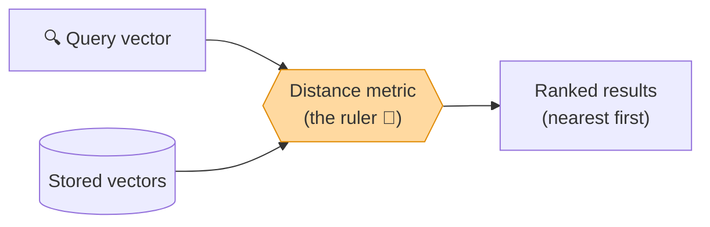

Different rulers give **different rankings**. Picking the wrong one gives poor search results.

### Distance vs Similarity

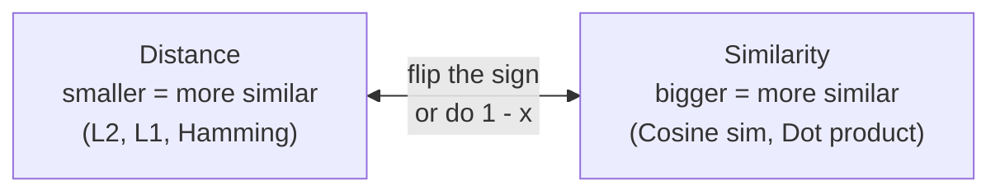

---

## 2. Setup

```bash
pip install numpy matplotlib
```

That is all you need. Every example uses only `numpy` and `matplotlib`.

---

## 3. The metrics at a glance

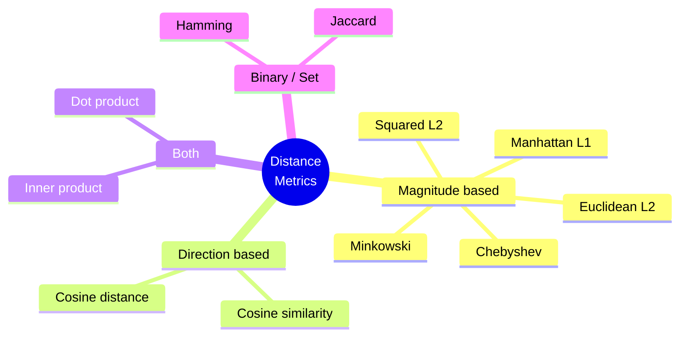

| Metric | Formula idea | Looks at | Best for |
|---|---|---|---|
| **Euclidean (L2)** | straight-line distance | position | image features, general embeddings, clustering |
| **Squared L2** | L2 without the square root | position | faster ranking (same order as L2) |
| **Manhattan (L1)** | sum of absolute differences | position | sparse / high-dim data, grid-like, robust to outliers |
| **Cosine** | angle between vectors | direction only | text embeddings, semantic search |
| **Dot product** | multiply and add | direction + length | recommenders, models trained for it |
| **Chebyshev (L∞)** | biggest single difference | worst dimension | "no feature may differ much" rules |
| **Hamming** | count of differing bits | bits | binary codes, hashes, binary quantization |
| **Jaccard** | overlap of two sets | sets | tags, keywords, sets of items |

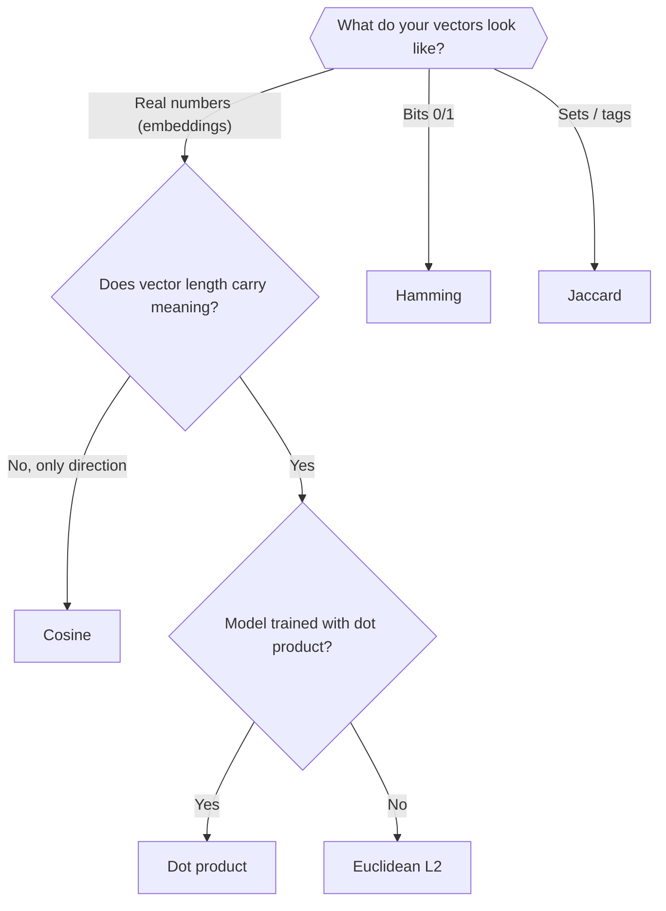

---

## 4. The 10 examples

---

### Example 1 — Euclidean distance (L2): the straight line 📐

The distance you would measure with a ruler.


**Formula:** `d(a, b) = √( Σ (aᵢ − bᵢ)² )`

```python
import numpy as np
import matplotlib.pyplot as plt

def euclidean(a, b):
    return np.sqrt(np.sum((a - b) ** 2))

a = np.array([1, 1])
b = np.array([4, 5])
print("Euclidean distance:", euclidean(a, b))      # 5.0

# Nearest neighbours of a query among random points
rng = np.random.default_rng(0)
points = rng.uniform(0, 10, size=(30, 2))
query = np.array([5.0, 5.0])
dists = np.array([euclidean(query, p) for p in points])
nearest = np.argsort(dists)[:3]

fig, ax = plt.subplots(figsize=(6, 6))
ax.scatter(points[:, 0], points[:, 1], c="lightgray", label="stored vectors")
ax.scatter(points[nearest, 0], points[nearest, 1], c="tab:green", s=90, label="3 nearest")
ax.scatter(*query, c="tab:red", marker="*", s=250, label="query")
for i in nearest:
    ax.plot([query[0], points[i, 0]], [query[1], points[i, 1]], "g--", alpha=0.6)
ax.set_title("Example 1: Euclidean (L2) nearest neighbours")
ax.legend(); ax.set_aspect("equal"); ax.grid(alpha=0.3)
plt.show()
```

**When to use:** the default choice when *absolute position and magnitude matter* (image features, sensor data, clustering).
**Watch out:** sensitive to scale. Normalise features first if they use different units.

---

### Example 2 — Squared L2 and Manhattan (L1) 🏙️

**Manhattan** is like walking through city blocks: you can only move along the grid.

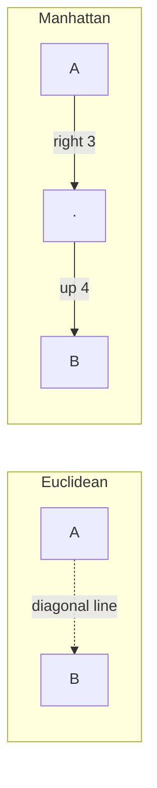

**Formulas:**
`L1 = Σ |aᵢ − bᵢ|`  and  `Squared L2 = Σ (aᵢ − bᵢ)²`

```python
import numpy as np
import matplotlib.pyplot as plt

a = np.array([1, 1])
b = np.array([4, 5])

l2 = np.sqrt(np.sum((a - b) ** 2))
l2_sq = np.sum((a - b) ** 2)
l1 = np.sum(np.abs(a - b))
print(f"L2 = {l2}, squared L2 = {l2_sq}, L1 = {l1}")   # 5.0, 25, 7

plt.figure(figsize=(6, 6))
plt.plot([a[0], b[0]], [a[1], b[1]], "b-", linewidth=3, label=f"Euclidean = {l2:.0f}")
plt.plot([a[0], b[0], b[0]], [a[1], a[1], b[1]], "r--", linewidth=3, label=f"Manhattan = {l1}")
plt.scatter(*a, c="k", s=100); plt.scatter(*b, c="k", s=100)
plt.text(a[0] - 0.4, a[1] - 0.3, "A"); plt.text(b[0] + 0.1, b[1] + 0.1, "B")
plt.xticks(range(0, 7)); plt.yticks(range(0, 7)); plt.grid(True)
plt.title("Example 2: Straight line vs city-block path")
plt.legend(); plt.gca().set_aspect("equal")
plt.show()
```

**Squared L2:** skipping the square root is *cheaper*, and the **ranking stays identical**, so many vector DBs (FAISS, Chroma `l2`) return squared L2.

**Manhattan when to use:** sparse data, very high dimensions, or when you want outliers to influence the distance less.

---

### Example 3 — Cosine similarity: only direction matters 🧭

Cosine measures the **angle**. Length is ignored.

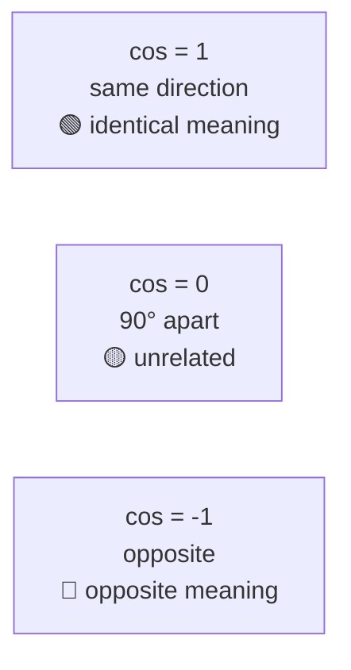

**Formula:** `cos(a, b) = (a · b) / (‖a‖ × ‖b‖)`   and   `cosine distance = 1 − cos`

```python
import numpy as np
import matplotlib.pyplot as plt

def cosine_sim(a, b):
    return np.dot(a, b) / (np.linalg.norm(a) * np.linalg.norm(b))

a = np.array([1.0, 2.0])
b = np.array([3.0, 6.0])     # same direction as a, but 3x longer
c = np.array([3.0, 1.0])     # different direction

print("cosine(a, b) =", round(cosine_sim(a, b), 3))   # 1.0 -> identical direction
print("cosine(a, c) =", round(cosine_sim(a, c), 3))
print("L2(a, b)     =", round(np.linalg.norm(a - b), 3))  # big, despite same direction

plt.figure(figsize=(6, 6))
for v, name, col in [(a, "a", "tab:blue"), (b, "b = 3a", "tab:green"), (c, "c", "tab:red")]:
    plt.arrow(0, 0, v[0], v[1], head_width=0.15, color=col, length_includes_head=True)
    plt.text(v[0] + 0.1, v[1] + 0.1, name, color=col, fontsize=12)
plt.xlim(0, 7); plt.ylim(0, 7)
plt.title("Example 3: a and b point the same way → cosine = 1")
plt.grid(alpha=0.3); plt.gca().set_aspect("equal")
plt.show()
```

**When to use:** **text and semantic search**. A long document and a short one on the same topic point the same way even if their vector lengths differ.

---

### Example 4 — Dot product (inner product): direction *and* length ✖️

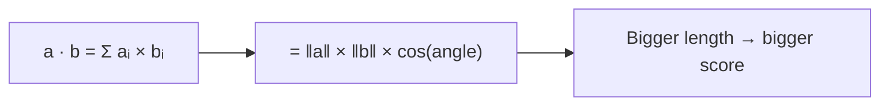

Imagine a recommender: each item vector's **length** may encode *popularity*, and the dot product with a user vector rewards popular items too.

```python
import numpy as np
import matplotlib.pyplot as plt

user = np.array([1.0, 1.0])
items = {
    "Niche perfect match": np.array([0.5, 0.5]),    # same direction, short
    "Popular good match":  np.array([2.0, 1.5]),    # similar direction, long
    "Blockbuster off-topic": np.array([4.0, 0.2]),  # different direction, very long
}

names = list(items)
dots = [np.dot(user, v) for v in items.values()]
coss = [np.dot(user, v) / (np.linalg.norm(user) * np.linalg.norm(v)) for v in items.values()]

fig, axes = plt.subplots(1, 2, figsize=(12, 4))
axes[0].barh(names, dots, color="tab:orange"); axes[0].set_title("Dot product (length counts)")
axes[1].barh(names, coss, color="tab:blue");   axes[1].set_title("Cosine (direction only)")
for ax in axes:
    ax.invert_yaxis(); ax.grid(alpha=0.3, axis="x")
plt.suptitle("Example 4: Dot product favours long vectors")
plt.tight_layout(); plt.show()
```

**When to use:**
- Recommendation models (two-tower, matrix factorisation) trained with dot product.
- Any model whose documentation says it was trained for inner product (e.g. many retrieval models).

**Watch out:** the "Blockbuster" can win just because it is long. Use it only if length is *meant* to carry information.

---

### Example 5 — Same data, three metrics, three different rankings 🏁

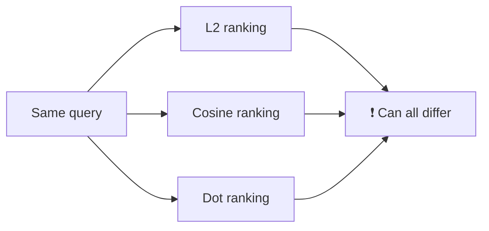

```python
import numpy as np
import matplotlib.pyplot as plt

query = np.array([1.0, 1.0])
docs = {
    "A (same direction, long)": np.array([3.0, 3.0]),
    "B (close and aligned)":    np.array([1.2, 0.9]),
    "C (other direction)":      np.array([0.1, 2.0]),
    "D (huge, slightly off)":   np.array([6.0, 4.0]),
}

def l2(a, b):  return np.linalg.norm(a - b)
def cos(a, b): return np.dot(a, b) / (np.linalg.norm(a) * np.linalg.norm(b))
def dot(a, b): return np.dot(a, b)

names = list(docs)
scores = {
    "L2 distance (low = best)": [l2(query, v) for v in docs.values()],
    "Cosine sim (high = best)": [cos(query, v) for v in docs.values()],
    "Dot product (high = best)": [dot(query, v) for v in docs.values()],
}

fig, axes = plt.subplots(1, 3, figsize=(15, 4), sharey=True)
for ax, (title, vals) in zip(axes, scores.items()):
    ax.barh(names, vals, color="steelblue")
    ax.set_title(title); ax.invert_yaxis(); ax.grid(alpha=0.3, axis="x")
plt.suptitle("Example 5: Same documents, different winners")
plt.tight_layout(); plt.show()

# Print winners
print("L2 winner    :", names[int(np.argmin(scores['L2 distance (low = best)']))])
print("Cosine winner:", names[int(np.argmax(scores['Cosine sim (high = best)']))])
print("Dot winner   :", names[int(np.argmax(scores['Dot product (high = best)']))])
```

**What you learn:** L2 picks **B** (physically closest), cosine picks one of the perfectly aligned vectors (**A** or **B**), and dot product picks **D** (largest). The metric defines "best".

---

### Example 6 — Normalisation: when all three agree ⚖️

If every vector has **length 1** (unit vectors), then:

- `dot product = cosine similarity`
- `squared L2 = 2 − 2 × cosine`

So all three produce the **same ranking**.


```python
import numpy as np
import matplotlib.pyplot as plt

rng = np.random.default_rng(1)
vecs = rng.normal(size=(40, 2)) * rng.uniform(0.5, 4, size=(40, 1))   # different lengths
query = np.array([2.0, 1.0])

def normalize(x):
    return x / np.linalg.norm(x, axis=-1, keepdims=True)

vn, qn = normalize(vecs), normalize(query)

cos_scores = vn @ qn
dot_scores = vn @ qn
l2_sq = np.sum((vn - qn) ** 2, axis=1)

print("Identity check  L2² == 2 - 2cos :", np.allclose(l2_sq, 2 - 2 * cos_scores))
rank_cos = np.argsort(-cos_scores)
rank_l2 = np.argsort(l2_sq)
print("Same ranking?                    :", np.array_equal(rank_cos, rank_l2))

fig, axes = plt.subplots(1, 2, figsize=(12, 5))
axes[0].scatter(vecs[:, 0], vecs[:, 1], alpha=0.7)
axes[0].set_title("Before: different lengths")
axes[1].scatter(vn[:, 0], vn[:, 1], alpha=0.7, c="tab:green")
axes[1].set_title("After normalising: all on the unit circle")
for ax in axes:
    ax.set_aspect("equal"); ax.grid(alpha=0.3); ax.axhline(0, c="k", lw=0.5); ax.axvline(0, c="k", lw=0.5)
plt.suptitle("Example 6: Normalisation puts every vector on a circle")
plt.show()
```

**Practical tip:** many embedding APIs return **already-normalised** vectors. Then use the *fastest* metric (dot product / inner product); you get cosine results at lower cost.

---

### Example 7 — Chebyshev & Minkowski: the shape of "distance" 🔷

**Minkowski** is a family: `d = ( Σ |aᵢ − bᵢ|ᵖ )^(1/p)`

- `p = 1` → Manhattan
- `p = 2` → Euclidean
- `p → ∞` → **Chebyshev** (largest single-coordinate difference)

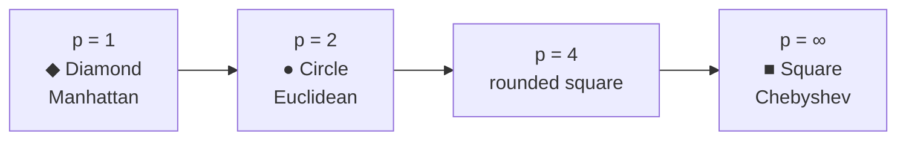

```python
import numpy as np
import matplotlib.pyplot as plt

a = np.array([0.0, 0.0])
b = np.array([3.0, 4.0])
diff = np.abs(a - b)
print("Manhattan (p=1) :", diff.sum())                 # 7
print("Euclidean (p=2) :", np.sqrt((diff**2).sum()))   # 5
print("Chebyshev (p=inf):", diff.max())                # 4

# Plot "all points at distance 1 from the origin" for several p
t = np.linspace(0, 2 * np.pi, 400)
plt.figure(figsize=(6, 6))
for p, label in [(1, "p=1 (Manhattan)"), (2, "p=2 (Euclidean)"), (4, "p=4")]:
    x = np.sign(np.cos(t)) * np.abs(np.cos(t)) ** (2 / p)
    y = np.sign(np.sin(t)) * np.abs(np.sin(t)) ** (2 / p)
    plt.plot(x, y, label=label)
plt.plot([-1, 1, 1, -1, -1], [-1, -1, 1, 1, -1], label="p=∞ (Chebyshev)")
plt.title("Example 7: Unit 'circles' for different distances")
plt.legend(); plt.grid(alpha=0.3); plt.gca().set_aspect("equal")
plt.show()
```

**When to use Chebyshev:** when *every* feature must stay within a tolerance ("no single sensor may differ by more than 2 units").
**Why it matters for vector DBs:** it shows that "distance" is just a *shape* of neighbourhood. L1 and L2 are the usual choices; Chebyshev is niche.

---

### Example 8 — Hamming distance: counting different bits 🔢

For **binary vectors**, count how many positions differ.

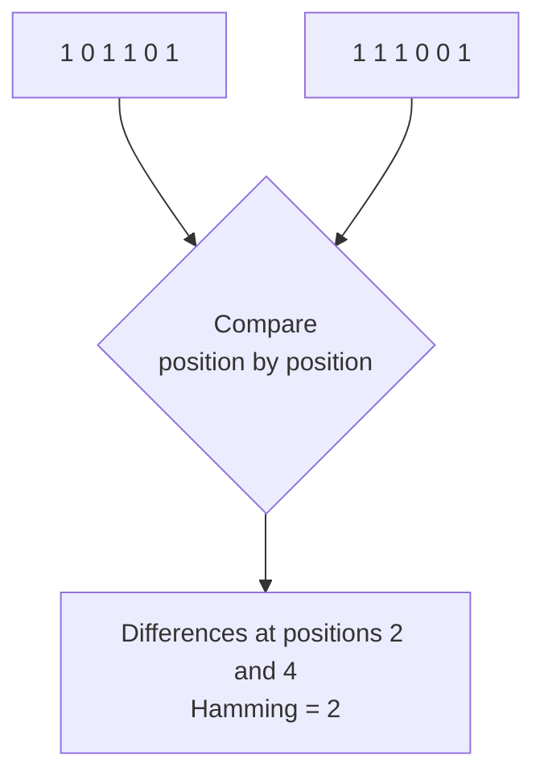

Vector DBs use this for **binary quantization**: shrink each float to 1 bit (positive → 1, negative → 0). That makes vectors **32× smaller** and search **very fast**.

```python
import numpy as np
import matplotlib.pyplot as plt

rng = np.random.default_rng(0)

# Pretend these are float embeddings, then binarise them
floats = rng.normal(size=(6, 16))
bits = (floats > 0).astype(int)

def hamming(a, b):
    return int(np.sum(a != b))

n = len(bits)
H = np.array([[hamming(bits[i], bits[j]) for j in range(n)] for i in range(n)])

plt.figure(figsize=(6, 5))
plt.imshow(H, cmap="magma_r")
plt.colorbar(label="Hamming distance")
for i in range(n):
    for j in range(n):
        plt.text(j, i, H[i, j], ha="center", va="center", color="white" if H[i, j] > 8 else "black")
plt.xticks(range(n), [f"v{i}" for i in range(n)])
plt.yticks(range(n), [f"v{i}" for i in range(n)])
plt.title("Example 8: Hamming distances between 16-bit codes")
plt.show()

print("Storage: 16 floats =", 16 * 4, "bytes  vs  16 bits =", 2, "bytes")
```

**When to use:** binary embeddings, perceptual image hashes, fingerprints, huge datasets where speed and memory matter more than perfect accuracy.

---

### Example 9 — Jaccard similarity: overlap of sets 🏷️

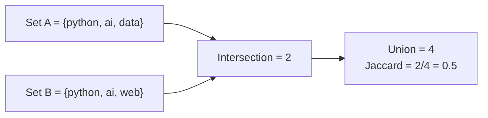

**Formula:** `Jaccard = |A ∩ B| / |A ∪ B|`   and   `Jaccard distance = 1 − Jaccard`

```python
import numpy as np
import matplotlib.pyplot as plt

def jaccard(a, b):
    return len(a & b) / len(a | b)

items = {
    "Post 1": {"python", "ai", "data"},
    "Post 2": {"python", "ai", "web"},
    "Post 3": {"cooking", "pasta", "italy"},
    "Post 4": {"python", "data", "ai", "ml"},
    "Post 5": {"travel", "italy", "food"},
}
names = list(items)
n = len(names)
J = np.array([[jaccard(items[i], items[j]) for j in names] for i in names])

plt.figure(figsize=(6, 5))
plt.imshow(J, cmap="Greens", vmin=0, vmax=1)
plt.colorbar(label="Jaccard similarity")
for i in range(n):
    for j in range(n):
        plt.text(j, i, f"{J[i, j]:.2f}", ha="center", va="center")
plt.xticks(range(n), names, rotation=45)
plt.yticks(range(n), names)
plt.title("Example 9: Tag overlap between posts")
plt.tight_layout(); plt.show()
```

**When to use:** tags, categories, keywords, shopping baskets, duplicate-document detection. Works on **sets** (or binary vectors), not on dense float embeddings.

---

### Example 10 — The curse of dimensionality 🌌

In very high dimensions, **all points become almost the same distance from each other**, so distances lose their power to separate near from far.

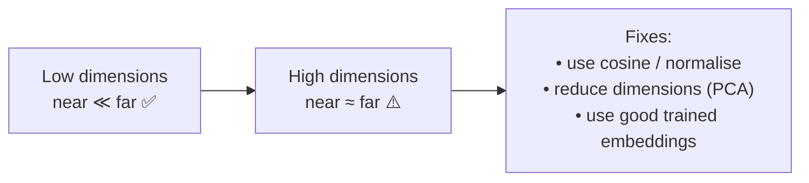

```python
import numpy as np
import matplotlib.pyplot as plt

rng = np.random.default_rng(42)
dims = [2, 5, 10, 25, 50, 100, 250, 500, 1000]
contrast = []

for d in dims:
    data = rng.uniform(size=(1000, d))
    q = rng.uniform(size=d)
    dist = np.linalg.norm(data - q, axis=1)
    # relative contrast: how different are the farthest and the nearest?
    contrast.append((dist.max() - dist.min()) / dist.min())

plt.figure(figsize=(7, 4))
plt.plot(dims, contrast, "o-")
plt.xscale("log")
plt.xlabel("Number of dimensions")
plt.ylabel("(farthest − nearest) / nearest")
plt.title("Example 10: Distances 'bunch up' as dimensions grow")
plt.grid(alpha=0.3)
plt.show()
```

**What you learn:** with random data, the gap between "nearest" and "farthest" shrinks as dimensions increase. Real trained embeddings have structure, so they still work well in hundreds or thousands of dimensions. This is one reason approximate-nearest-neighbour indexes (HNSW, IVF) and good embedding models matter.

---

## 5. Metrics in real vector databases

Almost every vector DB lets you choose the metric **when you create the index/collection**. It usually **cannot be changed later**, so choose it carefully.


| Database | Common metric options (names may vary by version, check the docs) |
|---|---|
| **FAISS** | `METRIC_L2`, `METRIC_INNER_PRODUCT` (use normalised vectors for cosine) |
| **Chroma** | `l2`, `cosine`, `ip` |
| **Pinecone** | `cosine`, `euclidean`, `dotproduct` |
| **Qdrant** | `Cosine`, `Dot`, `Euclid`, `Manhattan` |
| **Milvus** | `L2`, `IP`, `COSINE`, plus `HAMMING` / `JACCARD` for binary vectors |
| **pgvector (PostgreSQL)** | `<->` L2, `<#>` negative inner product, `<=>` cosine distance, `<+>` L1, plus Hamming / Jaccard for bit vectors |

### Tiny code snippets

```python
# --- Chroma: set metric at collection creation ---
import chromadb
client = chromadb.Client()
col = client.create_collection("docs", metadata={"hnsw:space": "cosine"})   # or "l2" / "ip"

# --- FAISS: L2 vs inner product ---
import faiss, numpy as np
d = 128
index_l2 = faiss.IndexFlatL2(d)
index_ip = faiss.IndexFlatIP(d)

# Cosine in FAISS = normalise first, then use inner product
x = np.random.rand(1000, d).astype("float32")
faiss.normalize_L2(x)
index_ip.add(x)
```

```sql
-- pgvector: pick the operator that matches your metric
SELECT id FROM items ORDER BY embedding <=> '[0.1, 0.2, 0.3]' LIMIT 5;   -- cosine distance
SELECT id FROM items ORDER BY embedding <-> '[0.1, 0.2, 0.3]' LIMIT 5;   -- L2 distance
```

> ⚠️ **Beware of the score's meaning.** Some DBs return a *distance* (smaller is better), others a *similarity* (larger is better). Always check which one you get.

---

## 6. Decision guide & cheat sheet

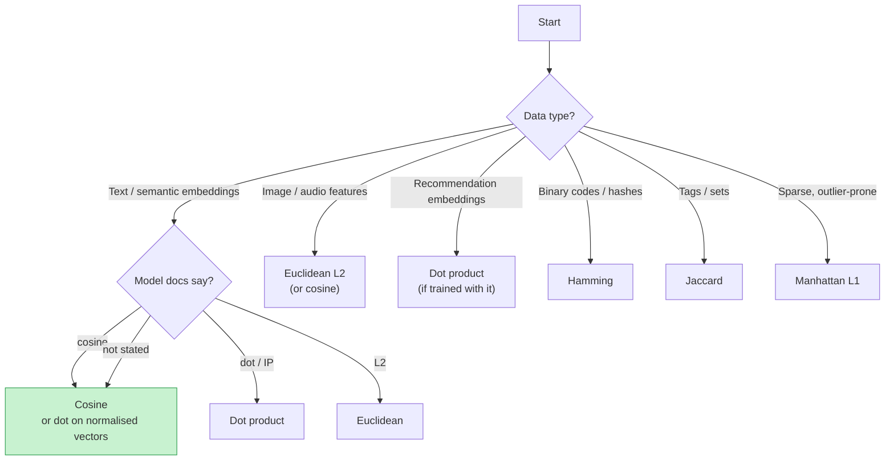

### Quick answers

| Question | Answer |
|---|---|
| I'm not sure, what should I pick? | **Cosine** for text embeddings; it is the safest default. |
| My embeddings are already normalised | Use **dot product / inner product** (same ranking as cosine, cheaper). |
| Does L2 vs squared L2 change results? | **No**, same ranking, squared is faster. |
| Does vector length carry meaning? | Yes → **dot product** or **L2**. No → **cosine**. |
| Millions of vectors, memory is tight | Consider **binary quantization + Hamming**. |
| My items are sets of tags | **Jaccard**. |
| Metric in the DB differs from the model's training metric | Expect **worse results**, so match them. |

### Key formulas

| Metric | Formula |
|---|---|
| L2 | `√Σ(aᵢ − bᵢ)²` |
| Squared L2 | `Σ(aᵢ − bᵢ)²` |
| L1 | `Σ|aᵢ − bᵢ|` |
| Cosine similarity | `a·b / (‖a‖‖b‖)` |
| Cosine distance | `1 − cosine similarity` |
| Dot product | `Σ aᵢbᵢ` |
| Chebyshev | `max|aᵢ − bᵢ|` |
| Hamming | `count(aᵢ ≠ bᵢ)` |
| Jaccard | `|A∩B| / |A∪B|` |

### 🚀 Practice ideas

1. In Example 5, change the query vector and see how the winners change.
2. In Example 6, remove the normalisation and watch the rankings diverge.
3. Create a Chroma collection three times (`l2`, `cosine`, `ip`) with the same data and compare the results.
4. Generate real sentence embeddings (see the Embeddings guide) and test whether cosine and L2 disagree on normalised vectors (they should not).
5. Use binary quantization on real embeddings and measure how often the top-5 results match the float results.

---

*Happy searching! 🎉*
