# 🧭 Embeddings for Absolute Beginners

A hands-on guide with **10 Python examples**, **matplotlib charts**, and **Mermaid diagrams**.

> **Goal:** After this guide you will know *what* embeddings are, *why* they matter, the *main types*, and how to *use* them in Python.

---

## 📚 Table of Contents

1. [What is an embedding?](#1-what-is-an-embedding)
2. [Setup](#2-setup)
3. [Types of embeddings (map)](#3-types-of-embeddings-map)
4. [The 10 examples](#4-the-10-examples)
5. [Cheat sheet & next steps](#5-cheat-sheet--next-steps)

---

## 1. What is an embedding?

An **embedding** is a list of numbers (a **vector**) that represents something (a word, sentence, image, song, user...) so that **similar things get similar numbers**.

Think of it like GPS coordinates: two cafés close on the map have similar coordinates. Embeddings are "coordinates for meaning".

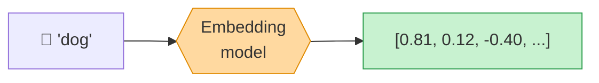

### Why do we need them?

Computers only understand numbers. Embeddings turn messy real-world data into numbers **while keeping meaning**.

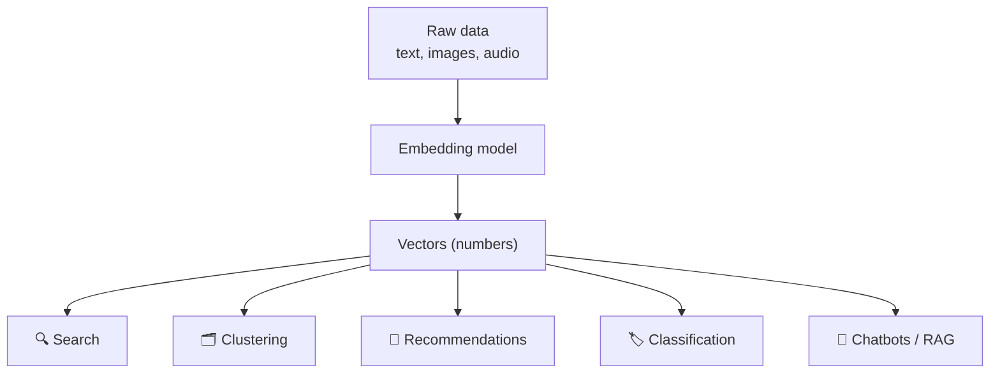

### The core idea: closeness = similarity

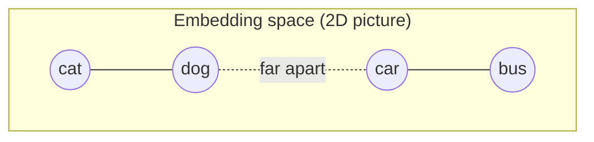

Animals sit near animals. Vehicles sit near vehicles.

---

## 2. Setup

```bash
pip install numpy matplotlib scikit-learn gensim sentence-transformers
```

Python 3.9+ recommended. Examples 1–6 and 10 need only `numpy`, `matplotlib`, `scikit-learn`. Example 7 needs `gensim`. Examples 8–9 need `sentence-transformers` (downloads a small model on first run).

---

## 3. Types of embeddings (map)

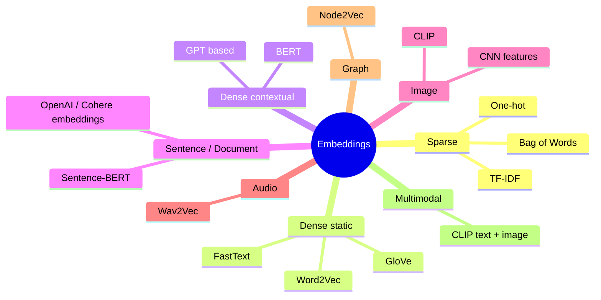

| Type | Idea | Size | Understands meaning? | Example tool |
|---|---|---|---|---|
| **One-hot** | 1 slot per word | huge, mostly 0 | ❌ | `sklearn` |
| **Bag of Words / TF-IDF** | word counts / importance | huge, sparse | ⚠️ barely | `TfidfVectorizer` |
| **Static word embeddings** | one vector per word | 50–300 | ✅ somewhat | Word2Vec, GloVe |
| **Contextual embeddings** | vector depends on the sentence | 768+ | ✅✅ | BERT |
| **Sentence embeddings** | one vector per sentence | 384–3072 | ✅✅ | Sentence-Transformers |
| **Image embeddings** | one vector per image | 512+ | ✅ | CNNs, CLIP |

### Evolution timeline

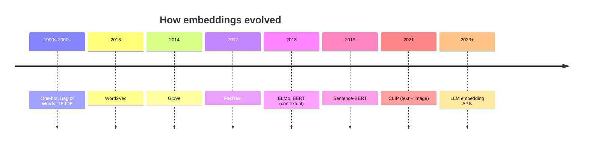

### Sparse vs Dense

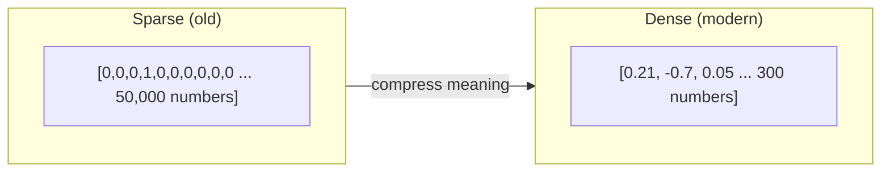

---

## 4. The 10 examples

---

### Example 1 — An embedding is just coordinates 📍

We invent 2D vectors for words and plot them. Dimension 1 ≈ "animal-ness", Dimension 2 ≈ "size".

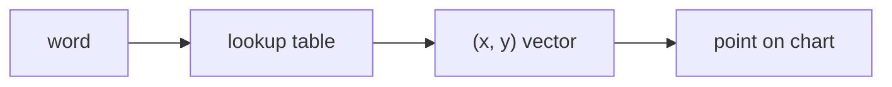

```python
import matplotlib.pyplot as plt

# Hand-made 2D embeddings: (animal-ness, size)
words = {
    "cat":      (0.90, 0.20),
    "dog":      (0.85, 0.35),
    "tiger":    (0.95, 0.70),
    "elephant": (0.90, 0.95),
    "bicycle":  (0.05, 0.25),
    "car":      (0.10, 0.60),
    "truck":    (0.12, 0.85),
}

plt.figure(figsize=(7, 5))
for word, (x, y) in words.items():
    plt.scatter(x, y, s=120)
    plt.text(x + 0.015, y + 0.015, word, fontsize=11)

plt.xlabel("Animal-ness  →")
plt.ylabel("Size  →")
plt.title("Example 1: Words as points in space")
plt.grid(alpha=0.3)
plt.show()
```

**What you learn:** similar words (cat/dog, car/truck) land close together.

---

### Example 2 — One-hot encoding (the "dumb" embedding) 🧱

Every word gets its own column. No meaning is captured: `cat` is as different from `dog` as from `car`.

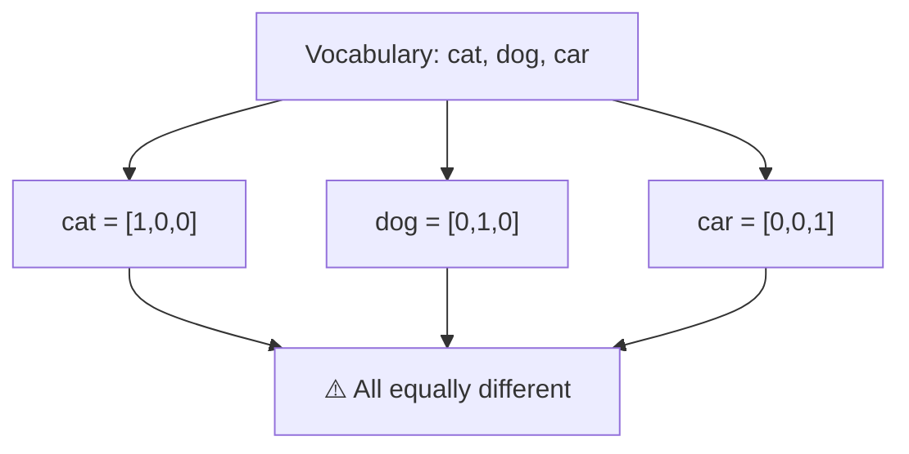

```python
import numpy as np
import matplotlib.pyplot as plt

vocab = ["cat", "dog", "car", "bus", "apple"]
one_hot = np.eye(len(vocab))          # identity matrix

plt.figure(figsize=(6, 4))
plt.imshow(one_hot, cmap="Blues")
plt.xticks(range(len(vocab)), vocab)
plt.yticks(range(len(vocab)), vocab)
plt.title("Example 2: One-hot vectors (each word = one column)")
plt.colorbar(label="value")
plt.show()

# Distance between cat and dog vs cat and car
d_cat_dog = np.linalg.norm(one_hot[0] - one_hot[1])
d_cat_car = np.linalg.norm(one_hot[0] - one_hot[2])
print("cat-dog distance:", round(d_cat_dog, 3))
print("cat-car distance:", round(d_cat_car, 3))   # identical! no meaning
```

**What you learn:** one-hot vectors can't tell that cats and dogs are related. Dense embeddings fix this.

---

### Example 3 — Bag of Words & TF-IDF (counting words) 🎒

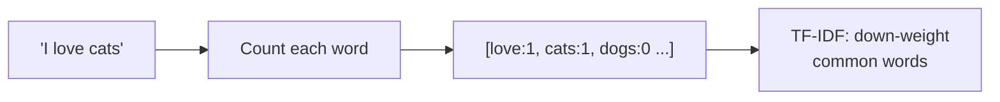

```python
import numpy as np
import matplotlib.pyplot as plt
from sklearn.feature_extraction.text import CountVectorizer, TfidfVectorizer

docs = [
    "I love cats and cats love me",
    "I love dogs",
    "Stock markets fell today",
    "Markets rallied as stocks rose",
]

bow = CountVectorizer()
tfidf = TfidfVectorizer()
X_bow = bow.fit_transform(docs).toarray()
X_tfidf = tfidf.fit_transform(docs).toarray()
terms = bow.get_feature_names_out()

fig, axes = plt.subplots(1, 2, figsize=(13, 4))
for ax, X, title in zip(axes, [X_bow, X_tfidf], ["Bag of Words (counts)", "TF-IDF (importance)"]):
    im = ax.imshow(X, cmap="YlOrRd", aspect="auto")
    ax.set_xticks(range(len(terms)))
    ax.set_xticklabels(terms, rotation=90)
    ax.set_yticks(range(len(docs)))
    ax.set_yticklabels([f"doc {i+1}" for i in range(len(docs))])
    ax.set_title(title)
    plt.colorbar(im, ax=ax)
plt.suptitle("Example 3: Sparse text embeddings")
plt.tight_layout()
plt.show()
```

**What you learn:** documents about the same topic share columns, but the method only matches *exact words* ("stocks" ≠ "markets").

---

### Example 4 — Measuring similarity: distance vs cosine 📏

Two ways to compare vectors:

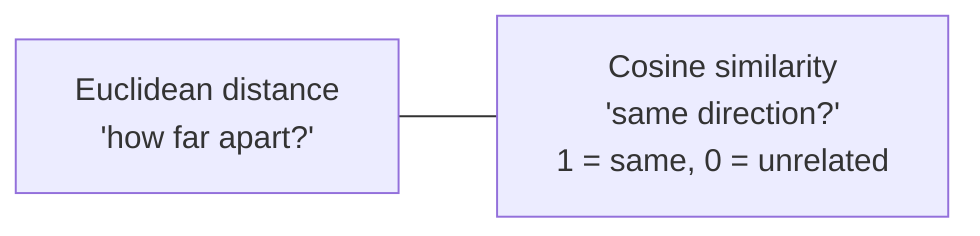

```python
import numpy as np
import matplotlib.pyplot as plt

cat   = np.array([0.9, 0.3])
dog   = np.array([0.8, 0.5])
car   = np.array([0.1, 0.9])

def cosine(a, b):
    return np.dot(a, b) / (np.linalg.norm(a) * np.linalg.norm(b))

print("cosine(cat, dog) =", round(cosine(cat, dog), 3))
print("cosine(cat, car) =", round(cosine(cat, car), 3))

plt.figure(figsize=(6, 6))
for vec, name, color in [(cat, "cat", "tab:blue"), (dog, "dog", "tab:green"), (car, "car", "tab:red")]:
    plt.arrow(0, 0, vec[0], vec[1], head_width=0.03, color=color, length_includes_head=True)
    plt.text(vec[0] + 0.02, vec[1] + 0.02, name, color=color, fontsize=12)

plt.xlim(0, 1.1); plt.ylim(0, 1.1)
plt.title("Example 4: Vectors as arrows (small angle = similar)")
plt.grid(alpha=0.3)
plt.gca().set_aspect("equal")
plt.show()
```

**What you learn:** `cat` and `dog` arrows point the same way (high cosine). `car` points elsewhere.

---

### Example 5 — Vector arithmetic: king − man + woman ≈ queen 👑

Embeddings can capture relationships as *directions*.

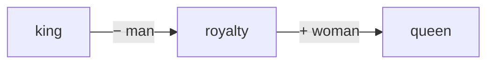

```python
import numpy as np
import matplotlib.pyplot as plt

# dims: (maleness, royalty)
emb = {
    "man":   np.array([1.0, 0.0]),
    "woman": np.array([0.0, 0.0]),
    "king":  np.array([1.0, 1.0]),
    "queen": np.array([0.0, 1.0]),
    "prince":np.array([0.9, 0.6]),
}

result = emb["king"] - emb["man"] + emb["woman"]
print("king - man + woman =", result)

# find nearest word
best = min(emb, key=lambda w: np.linalg.norm(emb[w] - result) if w not in ("king", "man", "woman") else 9)
print("Closest word:", best)

plt.figure(figsize=(6, 5))
for w, v in emb.items():
    plt.scatter(*v, s=120)
    plt.text(v[0] + 0.03, v[1] + 0.03, w, fontsize=12)

plt.annotate("", xy=emb["woman"], xytext=emb["man"], arrowprops=dict(arrowstyle="->", color="gray"))
plt.annotate("", xy=emb["queen"], xytext=emb["king"], arrowprops=dict(arrowstyle="->", color="gray"))
plt.xlabel("Maleness →"); plt.ylabel("Royalty →")
plt.title("Example 5: Gender is a direction in space")
plt.grid(alpha=0.3)
plt.show()
```

**What you learn:** the "man → woman" arrow is the same as "king → queen". Real models (Word2Vec, GloVe) learn this automatically.

---

### Example 6 — Building embeddings from scratch (co-occurrence + SVD) 🛠️

Idea: *"You shall know a word by the company it keeps."* Words appearing near the same neighbors get similar vectors.

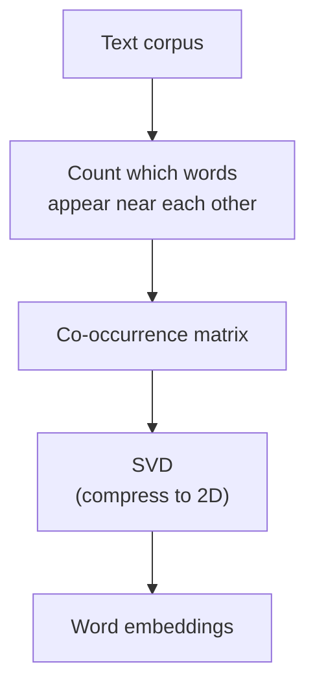

```python
import numpy as np
import matplotlib.pyplot as plt

corpus = [
    "cat drinks milk", "dog drinks water", "cat chases mouse", "dog chases cat",
    "cat eats fish", "dog eats meat",
    "car uses petrol", "bus uses diesel", "car needs road", "bus needs road",
    "driver drives car", "driver drives bus",
]

tokens = [s.split() for s in corpus]
vocab = sorted({w for s in tokens for w in s})
idx = {w: i for i, w in enumerate(vocab)}

# Co-occurrence counts inside each short sentence
M = np.zeros((len(vocab), len(vocab)))
for sent in tokens:
    for i, w in enumerate(sent):
        for j, c in enumerate(sent):
            if i != j:
                M[idx[w], idx[c]] += 1

# SVD → keep top 2 dimensions
U, S, Vt = np.linalg.svd(M)
emb2d = U[:, :2] * S[:2]

plt.figure(figsize=(8, 6))
for w, i in idx.items():
    plt.scatter(*emb2d[i], s=60)
    plt.text(emb2d[i, 0] + 0.03, emb2d[i, 1] + 0.03, w)
plt.title("Example 6: Embeddings learned from word co-occurrence")
plt.grid(alpha=0.3)
plt.show()
```

**What you learn:** without being told, `cat` and `dog` end up together, and `car` and `bus` end up together.

---

### Example 7 — Word2Vec with Gensim (real static embeddings) 🧠

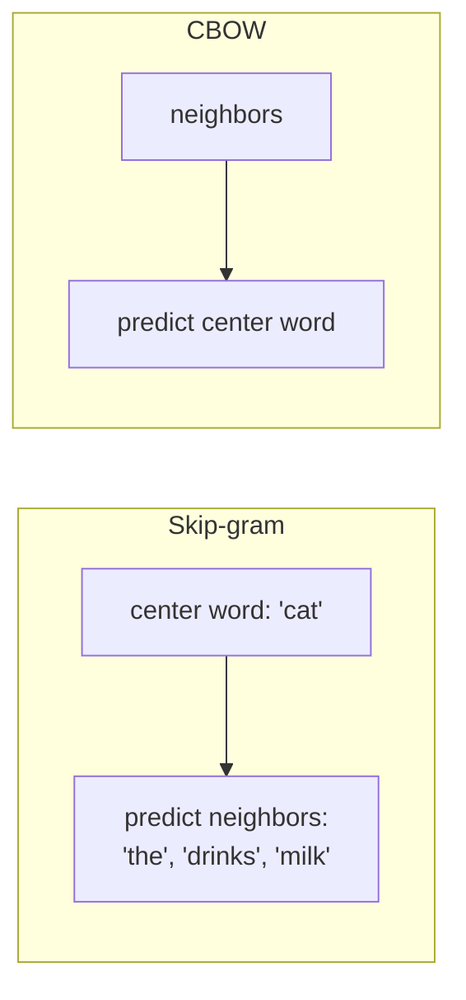

```python
import matplotlib.pyplot as plt
from gensim.models import Word2Vec
from sklearn.decomposition import PCA

sentences = [
    "cat drinks milk", "dog drinks water", "cat chases mouse", "dog chases cat",
    "cat eats fish", "dog eats meat", "car uses petrol", "bus uses diesel",
    "car needs road", "bus needs road", "driver drives car", "driver drives bus",
] * 50                                # repeat so the tiny model has enough data
sentences = [s.split() for s in sentences]

model = Word2Vec(sentences, vector_size=20, window=2, min_count=1, epochs=100, seed=1)

words = list(model.wv.index_to_key)
vectors = model.wv[words]               # shape (n_words, 20)
coords = PCA(n_components=2).fit_transform(vectors)   # 20D → 2D for plotting

plt.figure(figsize=(8, 6))
for (x, y), w in zip(coords, words):
    plt.scatter(x, y, s=60)
    plt.text(x + 0.02, y + 0.02, w)
plt.title("Example 7: Word2Vec embeddings (20D → 2D with PCA)")
plt.grid(alpha=0.3)
plt.show()

print("Most similar to 'cat':", model.wv.most_similar("cat", topn=3))
```

**What you learn:** `Word2Vec` learns dense vectors automatically. With a big corpus (Wikipedia) it learns the king/queen trick for real.
**Limitation:** one vector per word, so *"bank"* (river) and *"bank"* (money) are the same vector. Contextual models solve that (see below).

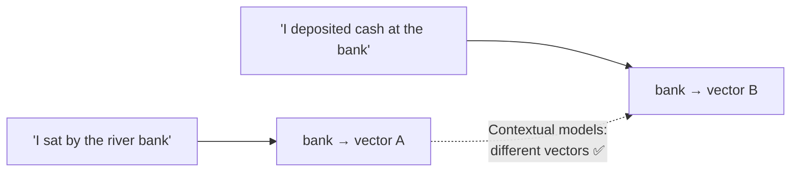

---

### Example 8 — Sentence embeddings + similarity heatmap 💬

Sentence embeddings capture *meaning*, not just matching words.

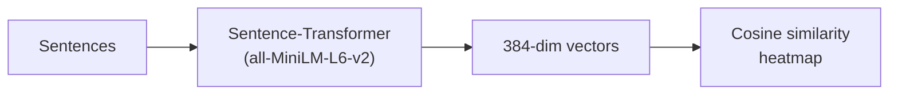

```python
import numpy as np
import matplotlib.pyplot as plt
from sentence_transformers import SentenceTransformer
from sklearn.metrics.pairwise import cosine_similarity

sentences = [
    "The cat sat on the mat.",
    "A kitten is resting on the rug.",
    "I love eating pizza.",
    "Pasta is my favourite food.",
    "The stock market crashed today.",
    "Share prices dropped sharply.",
]

model = SentenceTransformer("all-MiniLM-L6-v2")
emb = model.encode(sentences)
print("Embedding shape:", emb.shape)    # (6, 384)

sim = cosine_similarity(emb)

plt.figure(figsize=(7, 6))
plt.imshow(sim, cmap="viridis")
plt.colorbar(label="cosine similarity")
plt.xticks(range(len(sentences)), [f"S{i+1}" for i in range(len(sentences))])
plt.yticks(range(len(sentences)), [f"S{i+1}" for i in range(len(sentences))])
for i in range(len(sentences)):
    for j in range(len(sentences)):
        plt.text(j, i, f"{sim[i, j]:.2f}", ha="center", va="center", color="white", fontsize=8)
plt.title("Example 8: Sentence similarity (3 topic pairs light up)")
plt.show()
```

**What you learn:** "cat sat on mat" ≈ "kitten resting on rug" despite sharing *no words*. Pairs (1,2), (3,4), (5,6) show high scores.

---

### Example 9 — Semantic search engine 🔍

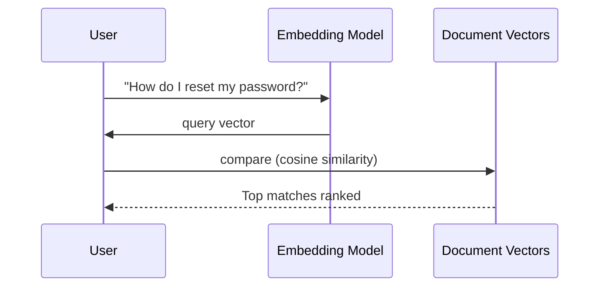

```python
import numpy as np
import matplotlib.pyplot as plt
from sentence_transformers import SentenceTransformer
from sklearn.metrics.pairwise import cosine_similarity

docs = [
    "How to change your account password",
    "Steps to recover a forgotten login",
    "Best pizza recipes for beginners",
    "Guide to training a puppy",
    "Fixing a flat bicycle tyre",
    "Update your billing and payment details",
]

model = SentenceTransformer("all-MiniLM-L6-v2")
doc_vecs = model.encode(docs)

query = "I can't log in, I forgot my password"
q_vec = model.encode([query])

scores = cosine_similarity(q_vec, doc_vecs)[0]
order = np.argsort(scores)[::-1]

for rank, i in enumerate(order, 1):
    print(f"{rank}. ({scores[i]:.2f}) {docs[i]}")

plt.figure(figsize=(8, 4))
plt.barh([docs[i] for i in order][::-1], scores[order][::-1], color="teal")
plt.xlabel("Cosine similarity to query")
plt.title(f'Example 9: Search results for "{query}"')
plt.tight_layout()
plt.show()
```

**What you learn:** the search finds password-related docs even though the exact words differ. This is the core of **RAG** (Retrieval-Augmented Generation) chatbots.

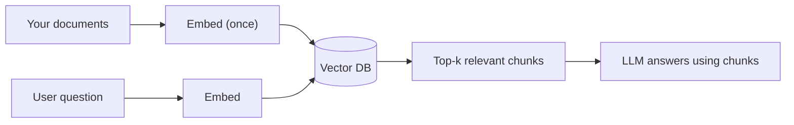

---

### Example 10 — Image embeddings: visualise 64-dim digits in 2D 🖼️

Each 8×8 digit image = 64 numbers (a simple embedding). We squash 64 → 2 dimensions with **PCA** and **t-SNE** to *see* the structure.

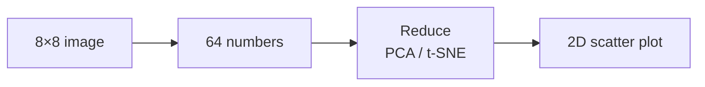

```python
import matplotlib.pyplot as plt
from sklearn.datasets import load_digits
from sklearn.decomposition import PCA
from sklearn.manifold import TSNE

digits = load_digits()
X, y = digits.data, digits.target     # X shape: (1797, 64)

X_pca = PCA(n_components=2).fit_transform(X)
X_tsne = TSNE(n_components=2, random_state=42, init="pca").fit_transform(X)

fig, axes = plt.subplots(1, 2, figsize=(14, 6))
for ax, data, title in zip(axes, [X_pca, X_tsne], ["PCA (linear)", "t-SNE (non-linear)"]):
    sc = ax.scatter(data[:, 0], data[:, 1], c=y, cmap="tab10", s=10)
    ax.set_title(title)
    ax.grid(alpha=0.3)
fig.colorbar(sc, ax=axes, label="digit")
plt.suptitle("Example 10: Handwritten digits in 2D - same digits cluster together")
plt.show()
```

**What you learn:** images of the same digit cluster together. Deep models (CNNs, CLIP) do the same for photos with 512+ dimensions.

---

## 5. Cheat sheet & next steps

### Which embedding should I use?

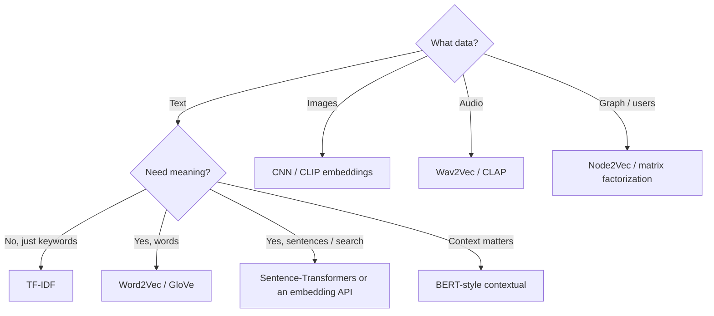

### Key words to remember

| Term | Meaning |
|---|---|
| **Vector** | A list of numbers |
| **Dimension** | How many numbers in the vector |
| **Dense** | Mostly non-zero, compact |
| **Sparse** | Mostly zeros, huge |
| **Cosine similarity** | Angle between vectors (−1 to 1) |
| **PCA / t-SNE / UMAP** | Squash many dimensions → 2D for plotting |
| **Vector database** | Stores embeddings for fast search (FAISS, Chroma, Pinecone) |

### The big picture

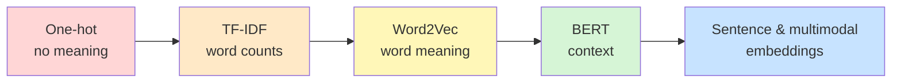

### 🚀 Practice ideas

1. Replace the sentences in Example 8 with your own and see which pairs match.
2. Build a mini FAQ search for your own notes using Example 9.
3. Try UMAP (`pip install umap-learn`) instead of t-SNE in Example 10.
4. Store embeddings in **ChromaDB** or **FAISS** and search thousands of documents.
5. Explore image-text search with **CLIP**.

---

*Happy embedding! 🎉*
