# Embeddings for Absolute Beginners (with Python)

A friendly, visual introduction to embeddings, common types, and 10 small Python examples.

> **Big idea:** An embedding turns something—such as a word, sentence, image, or product—into a list of numbers. Machine-learning systems can use those numbers to compare meaning, similarity, and relationships.

## What you will learn

- What an embedding is, without assuming prior machine-learning knowledge
- How vectors represent words and other things
- The difference between word, sentence, document, image, and other embeddings
- How cosine similarity works
- Why examples such as `king - man + woman ≈ queen` are interesting
- How to create simple plots with Matplotlib
- What embeddings can and cannot tell us

## 1. The basic idea

Imagine describing a fruit using numbers:

- sweetness
- size
- softness

A banana and a mango might have somewhat similar number patterns. A bus would be very different. Real embeddings usually have many more dimensions, and the dimensions often do **not** have simple human-readable names like “sweetness.”

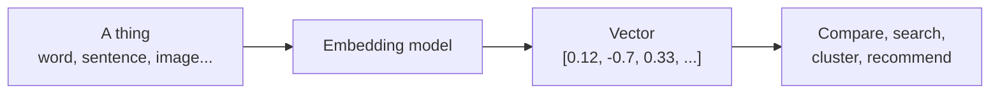

An embedding is a **vector**: an ordered list of numbers.

```python
word_vector = [0.12, -0.70, 0.33, 0.91]
print(len(word_vector))  # 4 dimensions in this toy example
```

The numbers above are invented for teaching. Real vectors are produced by a trained model.

## 2. Why numbers can represent meaning

A model learns patterns from examples. Words used in similar contexts often end up with related vectors. “Apple” and “banana” might be close in a space learned from language; “apple” and “spaceship” may be farther apart, depending on the model and context.

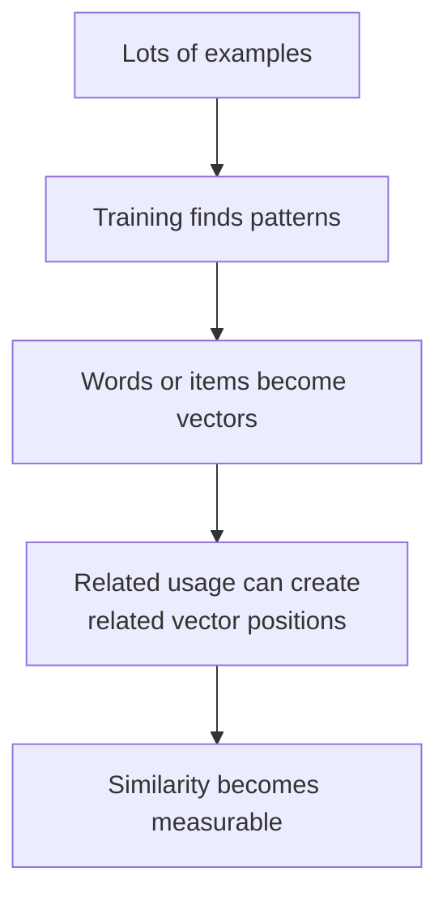

The map below is only an **illustration**. Real embeddings often have hundreds or thousands of dimensions, so a 2D plot is usually a projection and can lose information.

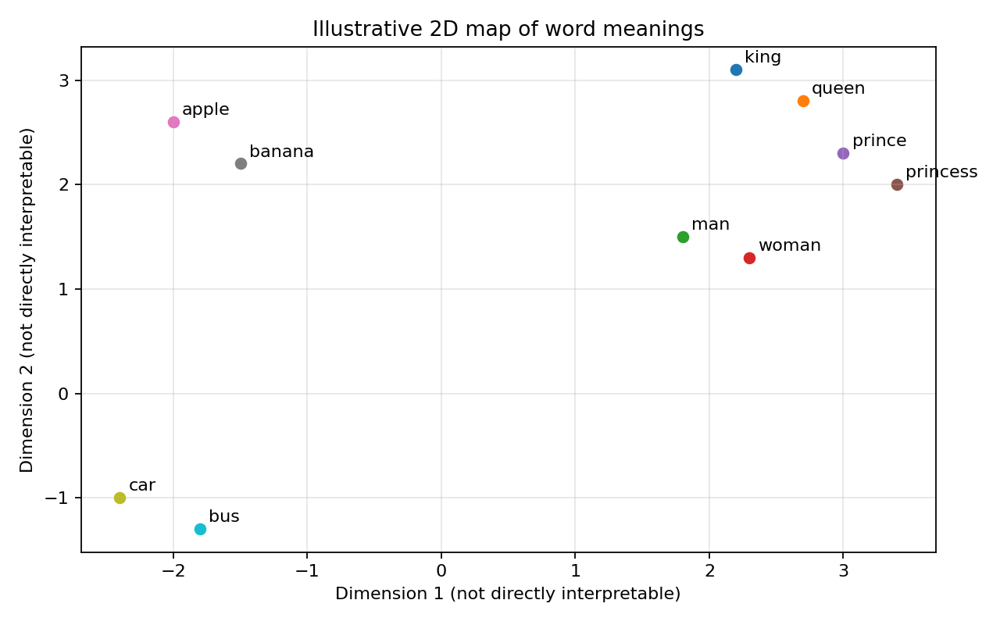

## 3. Common types of embeddings

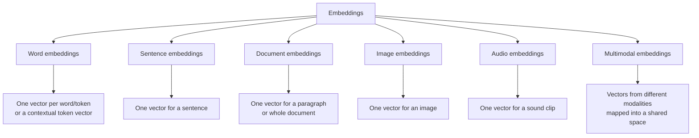

### A quick comparison

| Type | Input | Common uses |
|---|---|---|
| Word/token | A word or token | Language analysis, word similarity |
| Sentence | A sentence | Semantic search, duplicate detection, clustering |
| Document/chunk | A paragraph or text chunk | Search over notes, PDFs, and knowledge bases |
| Image | An image | Image search, grouping similar pictures |
| Audio | Speech or other audio | Audio retrieval, speech-related tasks |
| Multimodal | Text and/or images, sometimes audio/video | Find text related to an image, cross-modal search |

**Important distinction:** “Static” word embeddings (such as classic Word2Vec-style vectors) usually give a word one learned vector. Contextual models can represent the same word differently in different sentences. For example, “bank” in “river bank” and “bank account” may have different contextual representations.

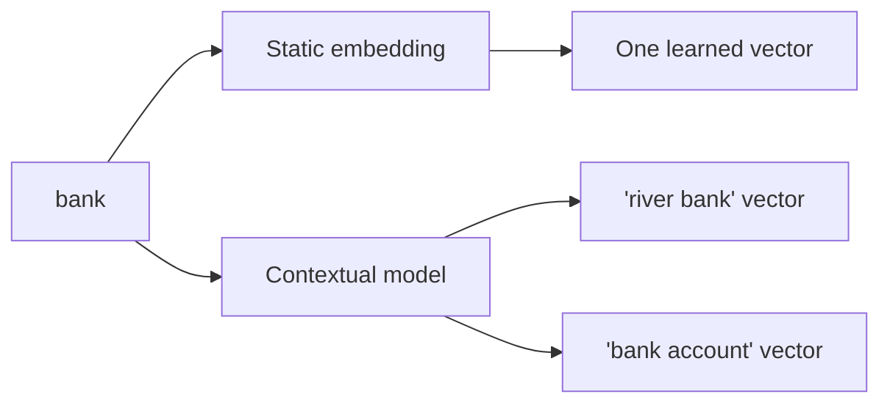

## 4. How do we compare vectors?

One common measure is **cosine similarity**. It compares the angle between two vectors:

- close to `1`: pointing in a similar direction
- around `0`: roughly unrelated directions
- close to `-1`: pointing in opposite directions

In real embedding spaces, interpretation depends on the model and task. Similarity is a useful signal, not a perfect measure of truth.

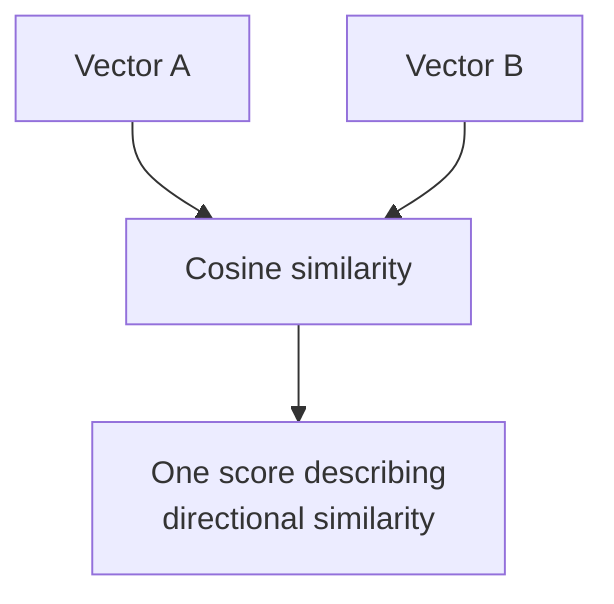

Formula:

\[
\text{cosine similarity}(A,B)=\frac{A\cdot B}{\|A\|\|B\|}
\]

Python example:

```python
import numpy as np

def cosine_similarity(a, b):
    a = np.array(a, dtype=float)
    b = np.array(b, dtype=float)
    denominator = np.linalg.norm(a) * np.linalg.norm(b)
    if denominator == 0:
        raise ValueError("Cosine similarity is undefined for a zero vector.")
    return float(np.dot(a, b) / denominator)

fruit_a = [1, 2, 1]
fruit_b = [1, 2, 0.8]
vehicle = [-1, 0, 2]

print(cosine_similarity(fruit_a, fruit_b))
print(cosine_similarity(fruit_a, vehicle))
```

## 5. Ten beginner-friendly Python examples

These examples start with tiny, **hand-made vectors** so you can see the maths. They are not real vectors learned from a language model. Later examples show how to use a real embedding model.

### Example 1 — A vector is just a list of numbers

```python
king = [0.8, 0.2, 0.9, 0.1]
queen = [0.7, 0.3, 0.8, 0.2]

print("King dimensions:", len(king))
print("Queen dimensions:", len(queen))
```

Both vectors have four dimensions. The numbers themselves do not automatically mean “royalty” or “gender”; they are just a toy illustration.

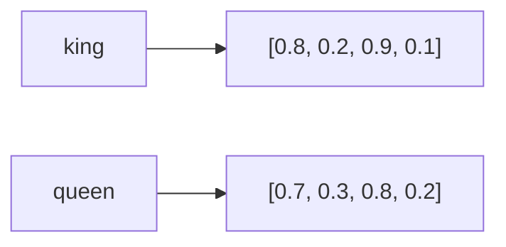

### Example 2 — Compare two vectors with cosine similarity

```python
import numpy as np

def cosine_similarity(a, b):
    a, b = np.array(a, float), np.array(b, float)
    denom = np.linalg.norm(a) * np.linalg.norm(b)
    return float(np.dot(a, b) / denom)

king = [0.8, 0.2, 0.9, 0.1]
queen = [0.7, 0.3, 0.8, 0.2]
banana = [-0.5, 0.9, -0.2, 0.7]

print("king vs queen:", cosine_similarity(king, queen))
print("king vs banana:", cosine_similarity(king, banana))
```

These scores are determined by the invented vectors, not by real-world word meaning.

### Example 3 — The famous `king - man + woman ≈ queen` idea

Classic word-vector examples sometimes show a relationship like:

`king - man + woman ≈ queen`

The intuition is that a relationship direction learned from many language examples can sometimes be reused. It is **not a universal rule**, and results vary by model, training data, and bias.

```python
import numpy as np

# Tiny made-up 2D vectors, designed only to illustrate the arithmetic.
man = np.array([1.0, 0.0])
woman = np.array([1.0, 1.0])
king = np.array([2.0, 0.0])
queen_target = np.array([2.0, 1.0])

guess = king - man + woman
print("Calculated vector:", guess)
print("Illustrative queen target:", queen_target)
print("Exact match in this toy example:", np.allclose(guess, queen_target))
```

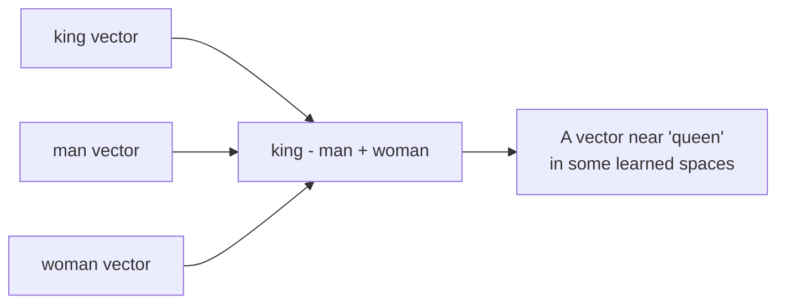

### Example 4 — Plot a toy semantic map with Matplotlib

```python
import matplotlib.pyplot as plt

toy_words = {
    "king": (2.2, 3.1),
    "queen": (2.7, 2.8),
    "man": (1.8, 1.5),
    "woman": (2.3, 1.3),
    "apple": (-2.0, 2.6),
    "banana": (-1.5, 2.2),
    "car": (-2.4, -1.0),
    "bus": (-1.8, -1.3),
}

for word, (x, y) in toy_words.items():
    plt.scatter(x, y)
    plt.annotate(word, (x, y), xytext=(5, 4), textcoords="offset points")

plt.title("Toy 2D embedding map (made-up coordinates)")
plt.xlabel("Dimension 1")
plt.ylabel("Dimension 2")
plt.grid(True, alpha=0.3)
plt.show()
```

The positions are deliberately hand-picked to make the idea visible. Real embeddings need a model, and reducing high-dimensional vectors to 2D can distort distances.

### Example 5 — Make a cosine-similarity chart

```python
import matplotlib.pyplot as plt

pairs = ["king–queen", "king–banana", "car–bus", "apple–banana"]
# Illustrative scores only; not model output.
scores = [0.91, 0.08, 0.86, 0.88]

plt.bar(pairs, scores)
plt.ylim(-1, 1)
plt.ylabel("Illustrative cosine similarity")
plt.title("Example similarity scores")
plt.xticks(rotation=15)
plt.grid(axis="y", alpha=0.3)
plt.show()
```

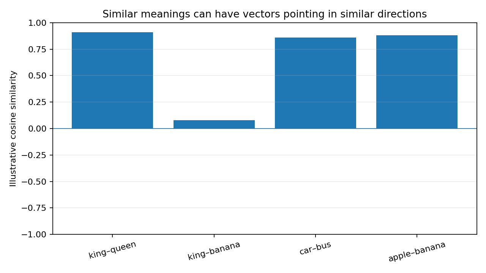

### Example 6 — Find the closest item in a tiny collection

```python
import numpy as np

def cosine_similarity(a, b):
    a, b = np.array(a, float), np.array(b, float)
    denom = np.linalg.norm(a) * np.linalg.norm(b)
    return float(np.dot(a, b) / denom)

vectors = {
    "king": [0.8, 0.2, 0.9],
    "queen": [0.7, 0.3, 0.8],
    "banana": [-0.5, 0.9, -0.2],
}
query = [0.75, 0.25, 0.85]

ranked = sorted(
    ((word, cosine_similarity(query, vector)) for word, vector in vectors.items()),
    key=lambda item: item[1],
    reverse=True,
)
print(ranked)
```

This is the basic idea behind vector search: embed a query, compare it with stored vectors, and return the nearest matches.

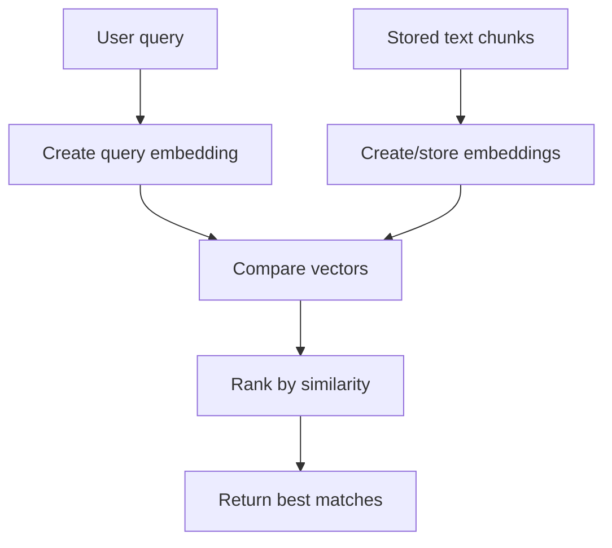

### Example 7 — Word embeddings versus sentence embeddings

A word vector represents a word/token (depending on the model). A sentence embedding represents a whole sentence in one vector. Sentence embeddings are often more convenient for semantic search.

```python
# Conceptual example: sentence vectors are shown as fake numbers.
sentence_1 = [0.2, 0.8, -0.1, 0.4]  # "How do I reset my password?"
sentence_2 = [0.25, 0.75, -0.05, 0.45]  # "I need to change my password."
sentence_3 = [-0.7, 0.1, 0.8, -0.2]  # "What is the weather?"

print(cosine_similarity(sentence_1, sentence_2))
print(cosine_similarity(sentence_1, sentence_3))
```

The numbers are placeholders. A real sentence embedding model must generate them.

### Example 8 — Generate real sentence embeddings with Sentence Transformers

Install the package first:

```bash
pip install sentence-transformers
```

Then run:

```python
from sentence_transformers import SentenceTransformer
from sklearn.metrics.pairwise import cosine_similarity

model = SentenceTransformer("all-MiniLM-L6-v2")

sentences = [
    "A dog is playing in the garden.",
    "A puppy is running outside.",
    "I am learning how to bake bread.",
]

embeddings = model.encode(sentences)
scores = cosine_similarity(embeddings)

print("Embedding matrix shape:", embeddings.shape)
print(scores.round(3))
```

The output is a matrix: one row per sentence, with one number per embedding dimension. The similarity matrix compares each sentence with every other sentence.

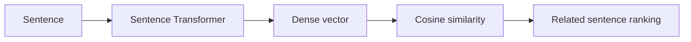

### Example 9 — A simple semantic-search demo

```python
from sentence_transformers import SentenceTransformer
from sklearn.metrics.pairwise import cosine_similarity
import numpy as np

documents = [
    "Reset your password from account settings.",
    "Bananas are a source of potassium.",
    "A car needs fuel or electricity to move.",
    "Use a strong password and enable two-factor authentication.",
]

model = SentenceTransformer("all-MiniLM-L6-v2")
doc_vectors = model.encode(documents)
query = "How can I make my account more secure?"
query_vector = model.encode([query])

scores = cosine_similarity(query_vector, doc_vectors)[0]
for idx in np.argsort(scores)[::-1]:
    print(f"{scores[idx]:.3f} | {documents[idx]}")
```

Semantic search can find related wording even when the query and document do not share the exact same words. For production use, consider chunking long documents, filtering results, and evaluating retrieval quality.

### Example 10 — Plot real sentence embeddings in 2D

Install the dependencies:

```bash
pip install sentence-transformers scikit-learn matplotlib
```

```python
import matplotlib.pyplot as plt
from sentence_transformers import SentenceTransformer
from sklearn.decomposition import PCA

sentences = [
    "A kitten is playing with a ball.",
    "A cat is chasing a toy.",
    "A puppy is running in the park.",
    "A bus is driving down the street.",
    "A train is arriving at the station.",
    "I like baking cakes and bread.",
]

model = SentenceTransformer("all-MiniLM-L6-v2")
vectors = model.encode(sentences)

# PCA compresses the vectors into 2 dimensions for plotting.
points_2d = PCA(n_components=2).fit_transform(vectors)

plt.figure(figsize=(9, 6))
for i, sentence in enumerate(sentences):
    x, y = points_2d[i]
    plt.scatter(x, y)
    plt.annotate(sentence, (x, y), xytext=(5, 4), textcoords="offset points")

plt.title("Sentence embeddings projected to 2D with PCA")
plt.xlabel("Principal component 1")
plt.ylabel("Principal component 2")
plt.grid(True, alpha=0.3)
plt.tight_layout()
plt.show()
```

The 2D positions are a compressed view of the original vectors. Do not assume every visible distance in a 2D chart perfectly reflects the original high-dimensional distance.

## 6. What does a typical embedding workflow look like?

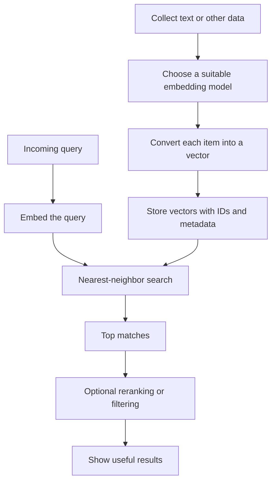

Typical applications:

- **Semantic search:** find relevant information by meaning
- **Recommendations:** find similar products, songs, articles, or users
- **Clustering:** group related items
- **Duplicate detection:** discover paraphrases or near-duplicates
- **Retrieval-augmented generation (RAG):** retrieve relevant passages for a language model
- **Cross-modal search:** use a suitable shared-space model to connect text and images

## 7. Vector arithmetic, visually

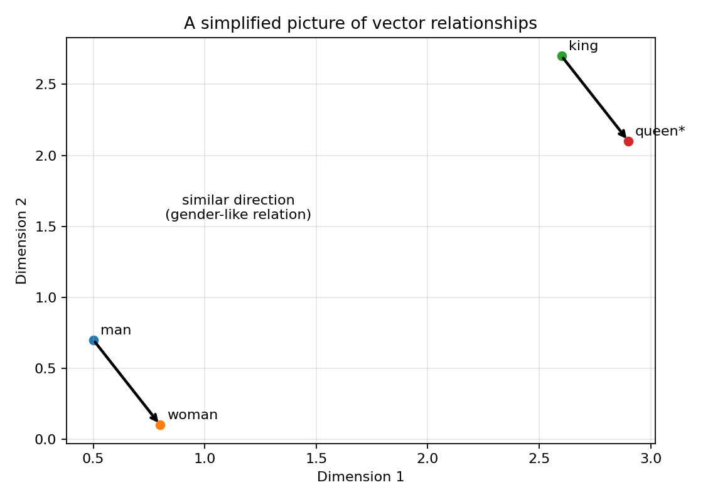

The classic analogy is often written:

\[
\vec{king}-\vec{man}+\vec{woman}\approx\vec{queen}
\]

Treat this as a historical, simplified demonstration—not a guarantee about all models or a statement that human concepts are perfectly captured by geometry. Embeddings can reflect stereotypes or other biases present in their training data.

## 8. Common beginner mistakes

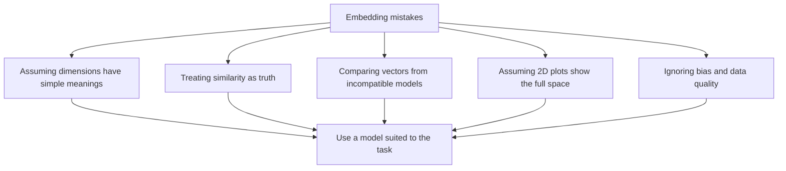

1. **Thinking each dimension has an obvious meaning.** Usually it does not.
2. **Assuming high similarity means identical meaning.** It means the model considers the vectors close under a particular measure.
3. **Mixing different embedding models.** Their vectors may not be directly comparable.
4. **Using toy vectors as if they were real.** Hand-made numbers teach the maths, but they do not represent a trained model.
5. **Trusting a 2D plot too much.** Projection loses information.
6. **Ignoring bias.** Embeddings can inherit unwanted associations from training data.

## 9. Quick recap

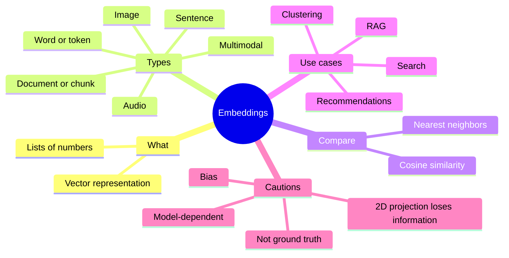

- An embedding is a numerical representation of an item.
- Similar items can have similar vectors, depending on the model.
- Cosine similarity is a common way to compare vectors.
- Word embeddings and sentence embeddings solve related but different problems.
- Real embedding models are needed for meaningful real-world results.
- Start with toy vectors to learn the maths, then try a pretrained model.

## 10. Suggested beginner learning path

1. Run Examples 1–6 using only Python and NumPy.
2. Change the toy vectors and observe how similarity scores change.
3. Run Example 8 with a pretrained sentence-transformer model.
4. Try semantic search on your own small list of notes.
5. Experiment with different models and evaluate whether the retrieved results are actually useful.

### Dependencies

For the toy examples:

```bash
pip install numpy matplotlib
```

For the real-model examples:

```bash
pip install sentence-transformers scikit-learn matplotlib
```

The first run of a pretrained model may download model files, so an internet connection may be required. Model names, package versions, and results can change over time.
