# RAG (Retrieval-Augmented Generation) in Simple Python

A beginner-friendly, end-to-end guide using **ChromaDB**, a **sentence-transformers embedding model**, and an **LLM via OpenRouter**. No LangChain.

---

## 1. What is RAG?

An LLM only knows what it learned during training. It does not know your private documents, your company policies, or yesterday's news. If you ask about them, it may guess or make things up (hallucinate).

**RAG fixes this in three steps:**

1. **Retrieve** the most relevant pieces of your documents for the question.
2. **Augment** the prompt by pasting those pieces in as context.
3. **Generate** the answer using the LLM, grounded in that context.

Think of it as an **open-book exam**: instead of answering from memory, the LLM first looks up the right pages, then answers.

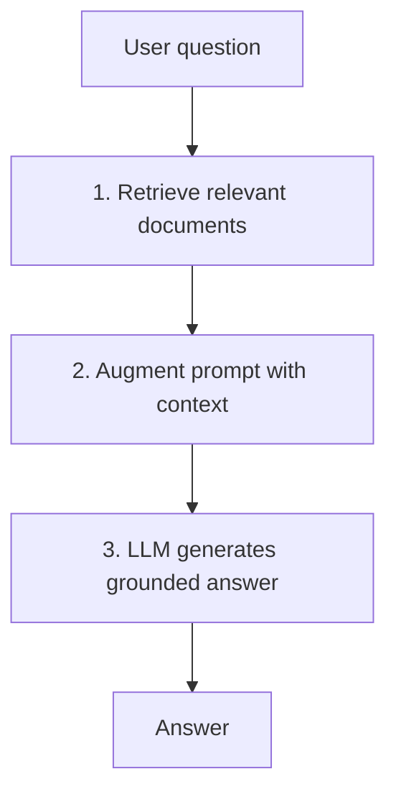

### LLM without RAG vs with RAG

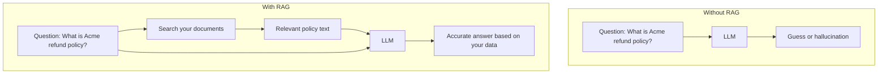

---

## 2. Key concepts

| Term | Simple meaning |
|---|---|
| **Embedding** | A list of numbers (a vector) that represents the *meaning* of text |
| **Embedding model** | The model that turns text into vectors |
| **Vector database** | A database that stores vectors and finds the most similar ones fast (ChromaDB) |
| **Chunk** | A small piece of a larger document |
| **Similarity search** | Finding stored vectors closest in meaning to the question vector |
| **Context** | The retrieved text you give the LLM |
| **Top-k** | How many chunks to retrieve (e.g. 3) |

### Embeddings: similar meaning means close vectors

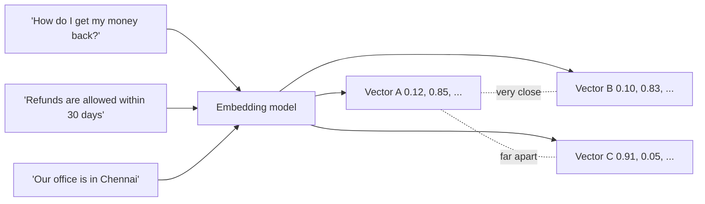

---

## 3. The full RAG pipeline

RAG has two phases: **Indexing** (done once, offline) and **Querying** (done on every question).

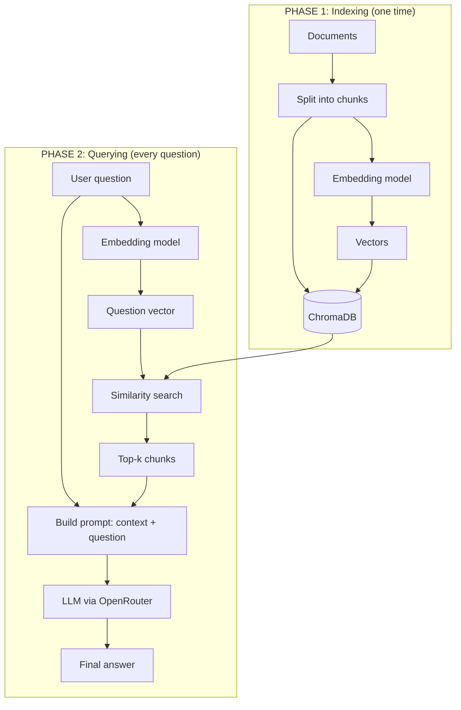

### Sequence of one question

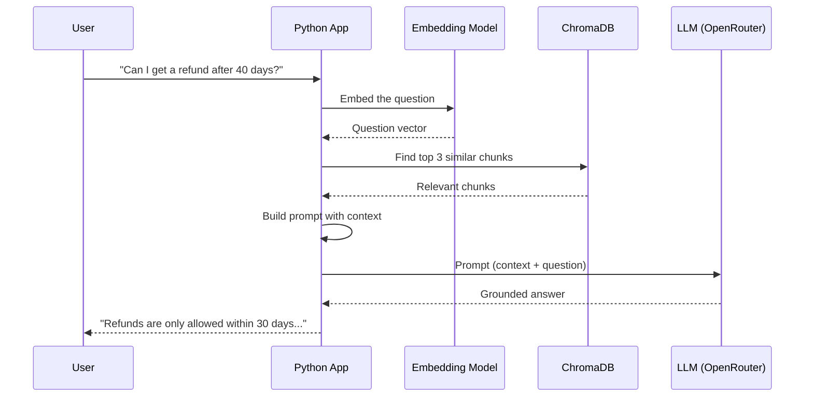

---

## 4. Setup

```bash
pip install chromadb sentence-transformers openai
```

```bash
# macOS / Linux
export OPENROUTER_API_KEY="your-key-here"

# Windows PowerShell
$env:OPENROUTER_API_KEY="your-key-here"
```

Get a key at https://openrouter.ai/keys. The first run downloads the small embedding model (about 90 MB).

---

## 5. Sample dataset

A tiny fictional company, **Acme Cloud**. Each entry is a short document with an id.

```python
documents = [
    {"id": "doc1", "text": "Acme Cloud offers three plans: Free, Pro, and Enterprise. The Free plan includes 5 GB of storage. The Pro plan costs 12 dollars per month and includes 500 GB of storage."},
    {"id": "doc2", "text": "Refund policy: Customers can request a full refund within 30 days of purchase. After 30 days, refunds are not available, but you can cancel anytime to avoid future charges."},
    {"id": "doc3", "text": "Acme Cloud support is available Monday to Friday, 9 AM to 6 PM IST. Enterprise customers get 24/7 phone support. Email support is at support@acmecloud.example."},
    {"id": "doc4", "text": "To reset your password, click 'Forgot password' on the login page. A reset link will be emailed to you and stays valid for 15 minutes."},
    {"id": "doc5", "text": "Acme Cloud data centers are located in Mumbai, Singapore, and Frankfurt. All data is encrypted at rest using AES-256 and in transit using TLS 1.3."},
    {"id": "doc6", "text": "The Enterprise plan includes single sign-on (SSO), audit logs, a 99.99 percent uptime SLA, and unlimited storage. Pricing is custom and requires contacting sales."},
]
```

---

## 6. Step-by-step build

### Step 1: Load the embedding model

```python
from sentence_transformers import SentenceTransformer

embedder = SentenceTransformer("all-MiniLM-L6-v2")

vec = embedder.encode("Hello world")
print(len(vec))  # 384 numbers
```

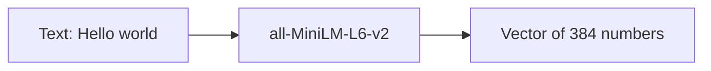

### Step 2: Chunk the documents

Our sample docs are already short, so each one is a single chunk. For longer documents, split them first. Here is a simple chunker with overlap:

```python
def chunk_text(text, chunk_size=200, overlap=40):
    """Split text into overlapping character chunks."""
    chunks = []
    start = 0
    while start < len(text):
        chunks.append(text[start:start + chunk_size])
        start += chunk_size - overlap
    return chunks
```

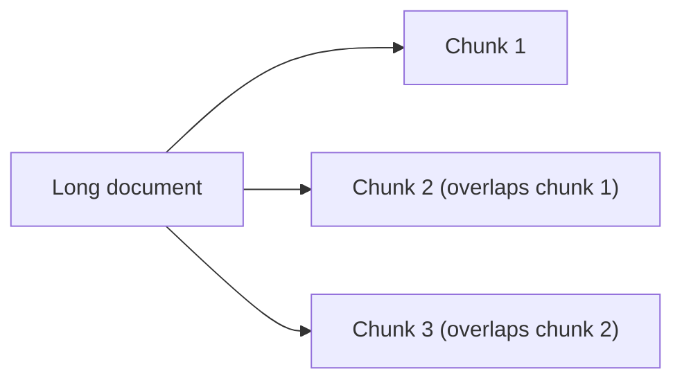

Overlap keeps a sentence from being cut in half and losing meaning at a boundary.

### Step 3: Create the ChromaDB collection and index the data

```python
import chromadb

chroma = chromadb.Client()  # in-memory; use PersistentClient(path="./db") to save to disk
collection = chroma.get_or_create_collection(name="acme_docs")

ids, texts = [], []
for doc in documents:
    for i, chunk in enumerate(chunk_text(doc["text"], chunk_size=300, overlap=50)):
        ids.append(f"{doc['id']}_chunk{i}")
        texts.append(chunk)

embeddings = embedder.encode(texts).tolist()

collection.add(ids=ids, documents=texts, embeddings=embeddings)
print(f"Indexed {collection.count()} chunks")
```

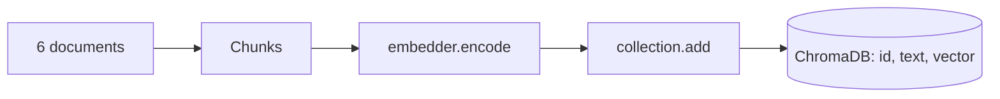

### Step 4: Retrieve relevant chunks

```python
def retrieve(question, k=3):
    q_vec = embedder.encode(question).tolist()
    results = collection.query(query_embeddings=[q_vec], n_results=k)
    return results["documents"][0], results["distances"][0]

chunks, distances = retrieve("Can I get my money back after 40 days?")
for c, d in zip(chunks, distances):
    print(f"[distance={d:.3f}] {c}\n")
```

Lower distance means more similar. The refund policy chunk should come first.

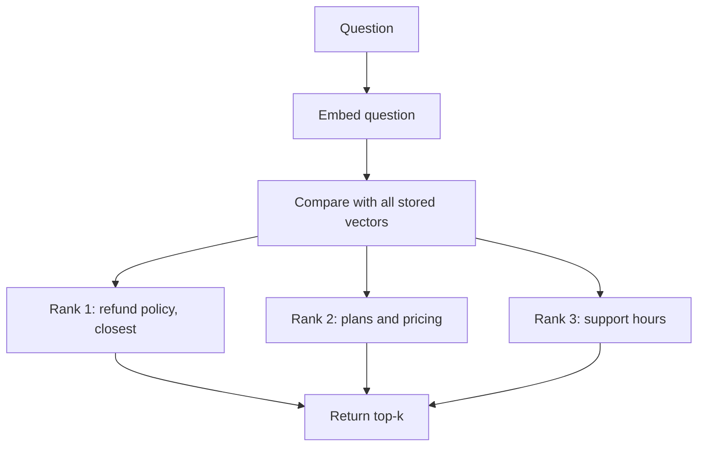

### Step 5: Build the augmented prompt

```python
def build_prompt(question, context_chunks):
    context = "\n\n".join(f"- {c}" for c in context_chunks)
    return f"""Answer the question using ONLY the context below.
If the answer is not in the context, say "I don't know based on the provided documents."

Context:
{context}

Question: {question}

Answer:"""
```

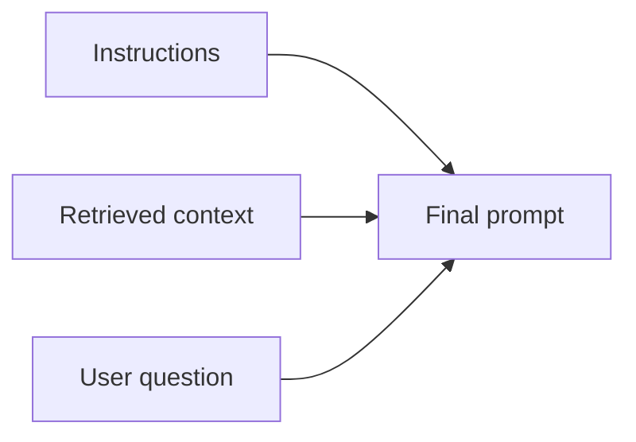

The instruction "use ONLY the context" is what keeps the LLM grounded and reduces hallucination.

### Step 6: Generate the answer with the LLM

```python
import os
from openai import OpenAI

llm = OpenAI(
    base_url="https://openrouter.ai/api/v1",
    api_key=os.environ["OPENROUTER_API_KEY"],
)

MODEL = "openai/gpt-4o-mini"

def generate(prompt):
    response = llm.chat.completions.create(
        model=MODEL,
        messages=[{"role": "user", "content": prompt}],
        temperature=0,
    )
    return response.choices[0].message.content
```

`temperature=0` makes answers more factual and repeatable, which suits RAG.

### Step 7: Put it together

```python
def rag_answer(question, k=3):
    chunks, _ = retrieve(question, k)
    prompt = build_prompt(question, chunks)
    return generate(prompt), chunks
```

---

## 7. Complete script (copy, paste, run)

Save as `rag_demo.py`:

```python
import os
import chromadb
from sentence_transformers import SentenceTransformer
from openai import OpenAI

# ---------- 1. Sample dataset ----------
documents = [
    {"id": "doc1", "text": "Acme Cloud offers three plans: Free, Pro, and Enterprise. The Free plan includes 5 GB of storage. The Pro plan costs 12 dollars per month and includes 500 GB of storage."},
    {"id": "doc2", "text": "Refund policy: Customers can request a full refund within 30 days of purchase. After 30 days, refunds are not available, but you can cancel anytime to avoid future charges."},
    {"id": "doc3", "text": "Acme Cloud support is available Monday to Friday, 9 AM to 6 PM IST. Enterprise customers get 24/7 phone support. Email support is at support@acmecloud.example."},
    {"id": "doc4", "text": "To reset your password, click 'Forgot password' on the login page. A reset link will be emailed to you and stays valid for 15 minutes."},
    {"id": "doc5", "text": "Acme Cloud data centers are located in Mumbai, Singapore, and Frankfurt. All data is encrypted at rest using AES-256 and in transit using TLS 1.3."},
    {"id": "doc6", "text": "The Enterprise plan includes single sign-on (SSO), audit logs, a 99.99 percent uptime SLA, and unlimited storage. Pricing is custom and requires contacting sales."},
]

# ---------- 2. Models and clients ----------
embedder = SentenceTransformer("all-MiniLM-L6-v2")
llm = OpenAI(
    base_url="https://openrouter.ai/api/v1",
    api_key=os.environ["OPENROUTER_API_KEY"],
)
MODEL = "openai/gpt-4o-mini"

# ---------- 3. Chunking ----------
def chunk_text(text, chunk_size=300, overlap=50):
    chunks, start = [], 0
    while start < len(text):
        chunks.append(text[start:start + chunk_size])
        start += chunk_size - overlap
    return chunks

# ---------- 4. Indexing ----------
chroma = chromadb.Client()
collection = chroma.get_or_create_collection(name="acme_docs")

ids, texts = [], []
for doc in documents:
    for i, chunk in enumerate(chunk_text(doc["text"])):
        ids.append(f"{doc['id']}_chunk{i}")
        texts.append(chunk)

collection.add(
    ids=ids,
    documents=texts,
    embeddings=embedder.encode(texts).tolist(),
)
print(f"Indexed {collection.count()} chunks\n")

# ---------- 5. Retrieval ----------
def retrieve(question, k=3):
    q_vec = embedder.encode(question).tolist()
    res = collection.query(query_embeddings=[q_vec], n_results=k)
    return res["documents"][0]

# ---------- 6. Prompt building ----------
def build_prompt(question, context_chunks):
    context = "\n\n".join(f"- {c}" for c in context_chunks)
    return f"""Answer the question using ONLY the context below.
If the answer is not in the context, say "I don't know based on the provided documents."

Context:
{context}

Question: {question}

Answer:"""

# ---------- 7. Generation ----------
def generate(prompt):
    response = llm.chat.completions.create(
        model=MODEL,
        messages=[{"role": "user", "content": prompt}],
        temperature=0,
    )
    return response.choices[0].message.content

# ---------- 8. RAG pipeline ----------
def rag_answer(question, k=3):
    chunks = retrieve(question, k)
    answer = generate(build_prompt(question, chunks))
    return answer, chunks

# ---------- 9. Try it ----------
if __name__ == "__main__":
    questions = [
        "Can I get a refund after 40 days?",
        "How much does the Pro plan cost and how much storage do I get?",
        "Where is my data stored and is it encrypted?",
        "How long is the password reset link valid?",
        "Does Acme Cloud have an office in London?",  # not in the docs
    ]

    for q in questions:
        answer, chunks = rag_answer(q)
        print(f"Q: {q}")
        print(f"A: {answer}")
        print(f"Top chunk used: {chunks[0][:80]}...\n")
```

---

## 8. Expected output (approximate)

```
Indexed 6 chunks

Q: Can I get a refund after 40 days?
A: No. Refunds are only available within 30 days of purchase, but you can cancel anytime to avoid future charges.

Q: How much does the Pro plan cost and how much storage do I get?
A: The Pro plan costs 12 dollars per month and includes 500 GB of storage.

Q: Where is my data stored and is it encrypted?
A: Data centers are in Mumbai, Singapore, and Frankfurt. Data is encrypted at rest with AES-256 and in transit with TLS 1.3.

Q: How long is the password reset link valid?
A: The reset link is valid for 15 minutes.

Q: Does Acme Cloud have an office in London?
A: I don't know based on the provided documents.
```

The last answer shows the grounding working: the information is not in the data, so the model declines instead of inventing something.

---

## 9. What happens for one question (worked example)

Question: **"Can I get a refund after 40 days?"**

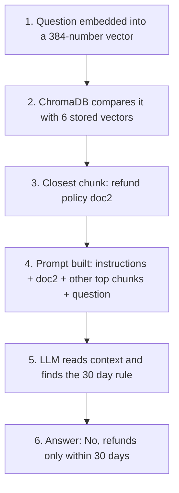

---

## 10. Persisting the database

The in-memory client disappears when the script ends. To keep your index on disk:

```python
chroma = chromadb.PersistentClient(path="./chroma_db")
collection = chroma.get_or_create_collection(name="acme_docs")
```

Then split your code into two scripts so you do not re-index every run:

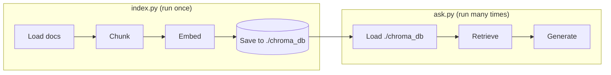

When adding documents, use `collection.upsert(...)` instead of `add(...)` so re-running does not raise duplicate id errors.

---

## 11. Show your sources (citations)

Add metadata when indexing so you can tell users where an answer came from:

```python
collection.add(
    ids=ids,
    documents=texts,
    embeddings=embeddings,
    metadatas=[{"source": i.split("_")[0]} for i in ids],
)

res = collection.query(
    query_embeddings=[embedder.encode(question).tolist()],
    n_results=3,
    include=["documents", "metadatas", "distances"],
)
print(res["metadatas"][0])   # e.g. [{'source': 'doc2'}, ...]
```

---

## 12. Common problems and fixes

| Problem | Likely cause | Fix |
|---|---|---|
| Wrong chunks retrieved | Chunks too big or too small | Try 200 to 500 characters with overlap |
| Answer ignores the context | Weak prompt | Keep the "use ONLY the context" instruction |
| LLM makes things up | Retrieval found nothing relevant | Check distances, return "I don't know" above a threshold |
| Missing details | `k` too low | Increase `k` to 4 or 5 |
| Duplicate id error | Re-running `add` | Use `upsert` or a fresh collection |
| Slow first run | Embedding model downloading | Normal, happens once |

### Adding a relevance threshold

```python
def retrieve(question, k=3, max_distance=1.2):
    q_vec = embedder.encode(question).tolist()
    res = collection.query(query_embeddings=[q_vec], n_results=k)
    return [
        doc for doc, dist in zip(res["documents"][0], res["distances"][0])
        if dist <= max_distance
    ]
```

If nothing passes the threshold, you can skip the LLM and reply that no relevant information was found. The right threshold depends on your data, so print a few distances and tune it.

---

## 13. Summary

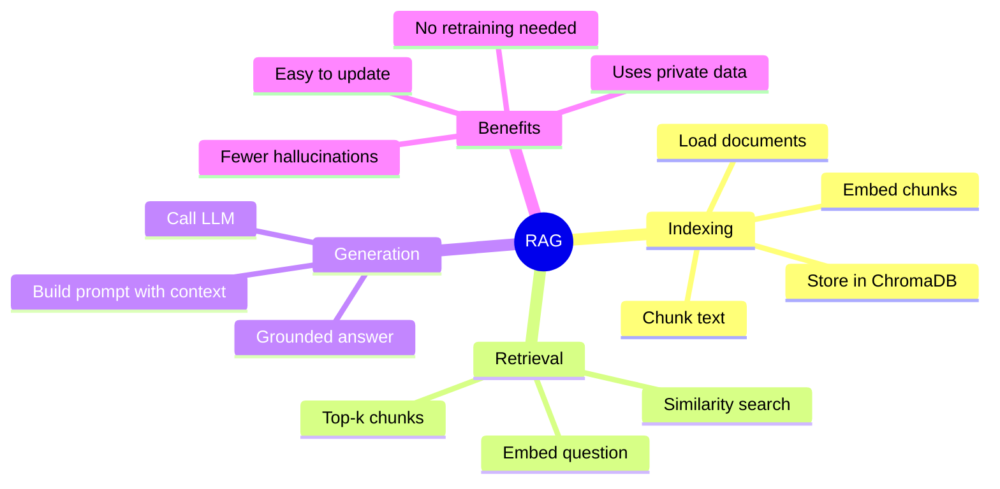

**One-line summary:** RAG = *search your documents first, then let the LLM answer using what was found.*

### Next steps to explore

- Load real files (PDF, text, markdown) instead of a Python list
- Try bigger embedding models for better accuracy
- Add re-ranking of retrieved chunks
- Add chat history so follow-up questions work
- Evaluate quality with a set of test questions and expected answers

Embedding Model Reference: https://huggingface.co/sentence-transformers/all-MiniLM-L6-v2
